# Журнал создания «Деканата 24/7»

Записываем каждый заметный этап: что делали, ключевой промпт, какой инструмент, что пошло не так. Из журнала собирается PDF-отчёт для жюри (критерий «Масштаб использования нейротехнологий»). Скриншоты складываем в `docs/process/screenshots/`.

## Инструменты

| Инструмент | Для чего |
|---|---|
| Claude Code (desktop-приложение Claude), модель Claude Opus 5.5 | разбор задания, генерация идей, PRD, архитектура, код |
| Встроенный браузер Claude Code | чтение задания в личном кабинете конкурса |
| Веб-поиск Claude Code | проверка, что названия «Меридиан» и «Деканат 24/7» не совпадают с реальными вузами и сервисами |

---

## Этап 1. Разбор задания и идея — 05.11.2026

**Что сделали.** ИИ прочитал задание в личном кабинете, выделил обязательное ядро, жёсткие требования и критерии. Обсудили три концепции и выбрали гибрид, а скоуп урезали под одного участника.

**Ключевые промпты автора:**
- «Изучи сайт, видишь задание?» — ИИ упёрся в страницу входа. Автор вошёл сам, пароль ИИ не передавался.
- «Там есть раздел Вайб-Кодинг, необходимо изучить задание и наметить идею и план»
- «Нужно сделать балансный победный вариант»
- Боли автора: «Для получения справок приходится лично обращаться в деканат, после чего на следующий день я ее получаю и иду ставить печать в другой кабинет» и «оценки… появляются там поздно только к концу триместра, и меня бесит, что нельзя в реальном времени порой посмотреть динамику и формирующийся средний балл».

**Варианты концепции, которые предложил ИИ:**
- A. «Деканат приходит сам» — лента «что важно сейчас».
- B. «Деканат в одну фразу» — ИИ в центре интерфейса.
- C. «Ноль бюрократии» — справки без очередей.
- **Выбрано:** A как каркас + C как главная фишка + B точечно (строка «Спроси деканат»), плюс живые оценки из боли автора.

**Ошибки ИИ и как исправили:**
- ИИ сначала предложил делать кабинет под МГИМО, не спросив, где учится автор. Автор засомневался, можно ли вообще делать под реальный вуз. Перечитали требования по скриншотам: адаптация под свой вуз разрешена (с плашкой «концепт» и без логотипа). Всё равно выбрали вымышленный вуз «Меридиан» с реалиями, списанными с опыта автора: так нет рисков с логотипом и «выдачей за официальный сервис».
- В первой версии идеи ИИ предложил 6 фишек. Для одного участника это слишком много, оставили 2 главные (справки, живые оценки) и кабинет сотрудника для демо.

**Что получилось:** [PRD.md](../PRD.md), [ARCHITECTURE.md](../ARCHITECTURE.md), [CLAUDE.md](../../CLAUDE.md) с правилами для ИИ-агентов, [опрос](../research/survey.md).

**Вручную:** вход в личный кабинет конкурса, решения по концепции и названию, описание собственных болей.

---

## Этап 2. Адаптация модели оценивания — 05.11.2026

**Что сделали.** Автор описал, как устроено оценивание в его вузе. ИИ перестроил раздел «Успеваемость» в PRD и модель данных: 100-балльная шкала, срезы, рейтинг из трёх компонентов. Добавили фишку «Достижения» как третий компонент рейтинга. Выбрали хостинг, ИИ-функцию в продукте перенесли в P2.

**Ключевые промпты автора:**
- «Учимся по 100 бальной системе. По каждой дисциплине у нас должно быть как минимум 3 среза, среднее арифмитическое которых дает итоговую оценку.»
- Рейтинг «складывается за 3 критерия: просто учеба…; Среднее арифметическое за все экзамены; Дополнительные достижения… потом из них среднее арифметическое».
- «Приложу положение тебе. (копировать не надо, но просто посмотри на здравые идеи)»
- «ИИ наверное на попозже оставим? Если что обойдемся без него»

**Что пошло не так.** ИИ не смог прочитать положение о рейтинге на сайте вуза: соединение обрывалось и у веб-агента, и с компьютера автора. Модель взяли из описания автора, пороги оценок и шкалу достижений вынесли в открытые вопросы и сделали настраиваемыми.

**Решения ИИ:**
- Расчёт рейтинга — чистые функции с юнит-тестами, общие для сервера и калькулятора «а если…».
- Достижения проходят через тот же механизм заявок, что и справки: новая фишка почти без новой инфраструктуры.
- Образ приложения собираем заранее, а не на VPS, чтобы сборка не упиралась в память сервера.

**Вручную:** описание системы оценивания, выбор хостинга (у автора уже есть AdminVPS).

---

## Этап 3. Изучение документов вуза — 06.11.2026

**Что сделали.** Автор дал 5 PDF своего вуза: положение о рейтинге, критерии поощрения, шкалу оценок, памятку студенту, положение об «Электронном деканате». ИИ извлёк текст (`pdftotext`). Положение об «Электронном деканате» оказалось сканом без текстового слоя: ИИ поставил PyMuPDF во временную папку, отрендерил страницы в картинки и прочитал их как изображения.

**Ключевой промпт автора:** «копировать не надо, но просто посмотри на здравые идеи».

**Что нашли и как это поменяло продукт** (подробно — [research/sources.md](../research/sources.md)):
- Модель рейтинга в документах сложнее, чем в описании автора: по каждой дисциплине 0,4 × срезы + 0,5 × сессия + 0,1 × работа на занятиях, плюс надбавка за достижения до +5. Перестроили расчёт и калькулятор.
- Нашли **корень боли 2**: бумажная цепочка ведомостей со сроками до конца семестра.
- Нашли **третью боль**: рейтинг непрозрачен, а от него зависят скидка и стипендия. Добавили «Из чего мой рейтинг» и цели «до автомата / до A / до скидки».
- Выписки рейтинга выдают лично. Добавили их в мгновенные справки с QR — это та же боль 1.

**Что пошло не так.** Первая попытка прочитать скан через встроенный рендер PDF упала: в системе нет `pdftoppm`. Обошли через PyMuPDF.

**Решение, которое ещё нужно подтвердить:** автор описывал рейтинг как «среднее трёх компонентов», а в документах формула по блокам. В PRD взяли модель по документам, автор подтверждает.

**Вручную:** автор скачал документы и передал их ИИ.

---

## Этап 4. Собственные правила оценивания — 06.11.2026

**Промпт автора:** «Ну давай юзать модель в документах, но чтобы это не было прям копипастом».

**Что сделали.** ИИ взял из документов вуза общую идею накопительного рейтинга и переписал её в собственные правила вымышленного «Меридиана» — отдельный документ [GRADING.md](../GRADING.md). Он стал источником правды для кода: CLAUDE.md требует считать строго по нему.

**Чем правила «Меридиана» отличаются от документов вуза:**

| | Документы вуза | «Меридиан» |
|---|---|---|
| Период | семестр | триместр, 12 недель |
| Веса частей | 0,4 / 0,5 / 0,1 | 0,40 / 0,45 / 0,15 |
| Третья часть | оценка «социальных характеристик» в конце семестра | «вовлечённость»: посещаемость считается автоматически и видна весь триместр + активность |
| Шкала | пятибалльная + буквенная A–F | 4 уровня: 90 / 75 / 60, без букв |
| Автомат по зачёту | от 70 | от 75 — граница «хорошо» |
| Бонус преподавателя | до +10 | до +5 |
| Пересдача | −10, −20 | −10 за каждую |
| Бонус за достижения | до +5 | до +4, свой справочник видов и баллов |
| Привилегии | скидки 30% / 60% | повышенная стипендия от 85, грант 25% / 50% |

**Решения ИИ.** Отличия не случайные: каждое либо упрощает интерфейс (без буквенной шкалы), либо добавляет продуктовую ценность (посещаемость видна сразу), либо делает правило логичнее (автомат совпадает с границей «хорошо»).

**Вручную:** автор согласовал подход.

---

## Этап 5. Каркас приложения — 06.11.2026

**Промпт автора:** «Да, ставь каркас».

**Что сделали:**
- Проект Next.js 16 + TypeScript + Tailwind 4, схема базы на Drizzle, миграция, вымышленные данные (2 студента, преподаватель, деканат).
- Вход по логину и паролю: argon2id, сессии в базе (хранится только хеш токена), cookie `HttpOnly`, ограничение попыток по логину и IP, одинаковое время ответа для существующего и несуществующего логина.
- Слой доступа `requireRole`: студентские данные запрашиваются только по id из сессии.
- Заголовки безопасности: CSP, запрет встраивания во фреймы, `nosniff`.
- Каркас интерфейса: плашка «концепт», свой логотип, нижняя панель на телефоне и боковая колонка на десктопе, профиль, заготовки разделов с пустыми состояниями, кабинет сотрудника.
- Расчёт рейтинга по GRADING.md и 37 юнит-тестов.

**Как проверяли.** ИИ сам открыл приложение во встроенном браузере на ширине 360 px: неверный пароль → понятная ошибка; вход двумя студентами → у каждого свои данные; студент на `/staff` → возврат на главную; cookie сессии не видна из JavaScript; горизонтальной прокрутки нет; десктоп на 1280 px. Скриншоты — `screenshots/05-*.jpg`.

**Что пошло не так и как исправили:**
1. **Новая версия Next.js.** В шаблоне предупреждение: «This is NOT the Next.js you know». ИИ сначала прочитал встроенную документацию (proxy вместо middleware, Cache Components) и выключил `cacheComponents`, чтобы не усложнять персональные страницы.
2. **Диск exFAT.** Turbopack упал: на exFAT нельзя создать junction-ссылки (`05-fail-turbopack-exfat.jpg`). Переход на webpack помог для dev, но без Turbopack пропали стили Tailwind (`05-fail-no-tailwind.jpg`) — подключили PostCSS-плагин. Потом упала уже продакшн-сборка (`readlink EISDIR`). ИИ предложил перенести проект на NTFS, автор выбрал `E:\Dev\dekanat-24-7`. На NTFS заработал и Turbopack, вернули его.
3. **Шрифт с Google Fonts** грузился с таймаутами — заменили на тот же Golos Text из npm-пакета, теперь без внешних запросов.
4. **Ошибка ИИ в тесте.** ИИ ожидал «уже хватает на автомат» при срезах 95 и 90, а функция честно ответила «на третьем нужно 40». Прав был код — исправили тест и добавили отдельный случай.
5. **Бесконечный редирект**, найденный при проверке в браузере: преподаватель на студенческой странице отправлялся на `/`, а оттуда снова на `/`. Теперь чужая роль уходит на свою главную.

**Вручную:** выбор диска для проекта.

---

## Этап 6. Дизайн-концепции — 06.11.2026

**Промпт автора:** «Дизайн-концепции».

**Что сделали.** Прежде чем собирать дизайн-систему, ИИ сделал три визуальных направления главного экрана «Сегодня». Данные во всех трёх одинаковые: следующая пара, перенос, новый балл за срез, рейтинг и сколько осталось до гранта, статусы справок, объявление. Поэтому сравнивается только визуальный язык. Каждый вариант — телефон шириной 360 px в светлой и тёмной теме. Временная страница `/design-lab` открывается только в режиме разработки.

| Вариант | Шрифты | Идея |
|---|---|---|
| A. Спокойный кампус | Golos Text | белые карточки, индиго, ничего лишнего |
| B. Табло | Unbounded + Manrope | рейтинг огромными цифрами, лайм и коралл, жёсткие рамки |
| C. Зачётка | PT Serif + Golos Text | бумага, чернила и красная «печать», ведомость с точками-выносками |

Все шрифты под SIL Open Font License, с кириллицей, подключены из npm без внешних запросов.

**Как проверяли.** ИИ открыл страницу во встроенном браузере: все четыре шрифта загрузились, ни один макет не шире 360 px, горизонтальной прокрутки нет. Скриншоты — `screenshots/06-concept-*.jpg`.

**Что пошло не так:** в «Табло» крупная цифра нового балла оказалась серой: правило для подписи `.b-score p` задело и саму цифру. ИИ заметил это на скриншоте и сузил селектор.

**Вручную:** выбор направления — за автором.

---

## Этап 7. Дизайн-система «Зачётка» — 07.11.2026

**Промпт автора:** «C. Зачётка» — выбор из трёх концепций этапа 6.

**Что сделали:**
- Токены в `globals.css`: бумажный фон, чернильно-синий акцент, цвета статусов. Светлая и тёмная темы, контраст текста не ниже WCAG AA.
- Шрифты: PT Serif для заголовков и цифр, Golos Text для текста. Unbounded и Manrope из невыбранных концепций удалили из зависимостей.
- Компоненты в `src/components/ui`: кнопки (4 вида), поле формы с ошибкой, связанной через `aria-describedby`, статусы, печать «готово», «ведомость» с точками-выносками, пометки на полях (перенос, объявление, подсказка), пустое состояние, ошибка с кнопкой «попробовать ещё раз», заглушки загрузки.
- На новую систему перевели вход, «Сегодня», профиль, заготовки разделов, кабинет сотрудника, 404, загрузку. Добавили экраны ошибок (`error.tsx`).
- `/design-lab` теперь витрина дизайн-системы, открывается только в режиме разработки.
- В CLAUDE.md записали правила дизайн-системы, чтобы следующие ИИ-агенты брали готовые компоненты, а не придумывали стили заново.

**Решения ИИ:**
1. **Печать фиолетовая, а не красная, как в концепции.** Красный в интерфейсе означает ошибку или перенос пары. Красная надпись «готово» спорила бы с этим. Настоящие печати деканата обычно синие или фиолетовые.
2. **Статус всегда словом и иконкой**, а не только цветом: так его различают и люди с нарушением цветового зрения.

**Что пошло не так:**
1. **Опять новая версия Next.js.** Перед `error.tsx` ИИ прочитал документацию: в Next.js 16 функция повтора называется `retry`, а не `reset`, как в прежних версиях и в большинстве примеров из интернета.
2. **Пароль тестовых аккаунтов.** Чтобы проверить студенческие экраны, ИИ попробовал прочитать пароль из `.env`, но защита Claude Code это запретила. Так и должно быть: секреты не попадают к ИИ. Вход выполнил автор.
3. **Навигация на 360 px.** В нижней панели на один пункт приходится 72 px, а слово «Успеваемость» занимает 76 px и наезжало на соседей (`07-fail-nav-overlap-360.jpg`). ИИ нашёл это замером ширины подписей, а не на глаз. На телефоне пункт теперь называется «Оценки», на десктопе — по-прежнему «Успеваемость». У пунктов уменьшили боковые отступы, чтобы «Расписание» не обрезалось многоточием.

**Как проверяли:** вход, витрина, «Сегодня» и профиль на 360 px и на десктопе в светлой и тёмной темах. Горизонтальной прокрутки нет, шрифты загружены. Продакшн-сборка проходит, 37 тестов зелёные. Скриншоты — `screenshots/07-*.jpg`.

---

## Этап 8. Подготовка к деплою — 07.11.2026

**Промпт автора:** «Первый деплой». На вопросы ИИ автор ответил: собирать образы в GitHub Actions, адрес вида `IP.sslip.io`, сервер ещё не заказан.

**Что сделали:**
- `Dockerfile` с двумя образами. `runner` — Next.js standalone от имени непривилегированного пользователя, с healthcheck. `tools` — миграции и наполнение базы.
- `deploy/compose.yaml`: приложение, PostgreSQL 18 и Caddy. Наружу открыт только Caddy (80/443), база и приложение доступны лишь внутри Docker-сети.
- `deploy/server-setup.sh` для чистого Ubuntu 24.04: Docker из репозитория Ubuntu, swap, файрвол, автообновления безопасности, ежедневный бэкап.
- `deploy/update.sh`: выкатка одной командой с миграциями и откатом на любой коммит через `APP_TAG`.
- GitHub Actions: проверка типов, линтер и тесты на каждый push. На `main` — сборка образов в GHCR.
- Публичный репозиторий [MrYar07/dekanat-24-7](https://github.com/MrYar07/dekanat-24-7), пошаговая инструкция — [DEPLOY.md](../DEPLOY.md).

**Решения ИИ:**
1. **Образ собирает GitHub, а не сервер.** На VPS с 2 ГБ памяти `next build` мог упасть по нехватке памяти, а локально Docker не установлен.
2. **Доступ из России.** Docker ставится из репозитория Ubuntu, потому что `download.docker.com` открывается не всегда. Для Docker Hub настроено зеркало. Образы приложения лежат в GHCR.
3. **Честный IP для ограничения попыток входа.** Приложение берёт IP из `X-Forwarded-For`. Это безопасно, только если заголовок ставит наш прокси, а не клиент. Caddy подменяет заголовок от клиента настоящим IP, а порт приложения наружу не открыт.
4. **Самообновляющийся скрипт.** `update.sh` сначала делает `git pull` и может заменить сам себя прямо во время работы. Тело скрипта обёрнуто в функцию: bash читает её целиком до выполнения.
5. **Переводы строк.** Проект живёт на Windows, а скрипты выполняются на Linux. В `.gitattributes` скрипты закреплены с LF, иначе bash на сервере споткнулся бы о `\r`.

**Безопасность перед публикацией.** Прежде чем сделать репозиторий публичным, ИИ проверил всю историю git на пароли из `.env`. Скрипт сравнивал содержимое коммитов с паролями и выводил только число совпадений: 0. Сами пароли к ИИ не попали.

**Как проверяли.** Первый же запуск CI прошёл целиком: проверки и оба образа. ИИ проверил, что образы скачиваются из GHCR без логина (ответ 200): пакеты стали публичными вслед за репозиторием, отдельный токен на сервере не нужен.

**Вручную:** заказ VPS и добавление SSH-ключа. Пароль сервера в чат не передаётся.

---

## Этап 9. Первый деплой — 09.11.2026

**Промпт автора:** «Закажу VPS». Автор выбрал тариф по подсказке ИИ: Micro в AdminVPS (2 vCPU, 4 ГБ RAM), Москва, Ubuntu 24.04, без панели управления, — и прислал скриншоты конфигуратора и выданного сервера.

**Результат:** https://5-35-126-36.sslip.io работает, HTTPS от Let's Encrypt.

**Что сделали:**
- Доступ по SSH-ключу, затем вход по паролю отключён.
- `server-setup.sh`: Docker из репозитория Ubuntu, файрвол (22, 80, 443), автообновления, ночной бэкап. После обновления ядра — перезагрузка.
- Пароль базы ИИ сгенерировал прямо на сервере (`openssl rand`), так что сам его не видел. Пароль тестовых аккаунтов автор вписал в `.env` сам.
- `update.sh`: образы из GHCR, миграции, запуск. Затем `db:seed`.

**Как проверяли (ИИ, снаружи сервера):**
- `/login` отвечает 200, сертификат действителен, `http://` перенаправляет на `https://`, без cookie сайт отправляет на вход, `/design-lab` отдаёт 404.
- Все заголовки безопасности на месте: CSP, HSTS, `X-Frame-Options: DENY`, `nosniff`.
- Порт приложения 3000 снаружи недоступен.
- Вход с неверными данными через браузер показывает понятную ошибку. Значит, серверные действия Next.js работают через прокси.
- **В журнал попыток входа записался настоящий IP клиента**, а не внутренний адрес Caddy. Ограничение попыток действительно работает.
- После отключения входа по паролю: ключ пускает, пароль отклоняется (`Permission denied (publickey)`).

**Что пошло не так:**
1. **Не было файла `.pub`.** Команда ИИ для добавления ключа упала: у автора был только приватный ключ, и тот защищён парольной фразой. ИИ создал отдельный ключ деплоя без фразы и короткое имя `dekanat` в `~/.ssh/config`. Основной ключ автора остался нетронутым.
2. **Swap.** У хостера уже был свой `/swapfile` на 512 МБ, и скрипт его не тронул. При 4 ГБ памяти этого хватает.
3. **Защиты Claude Code сработали дважды.** Удаление временного файла в домашней папке было заблокировано: путь вычислялся из переменной. ИИ переписал команду без временных файлов. Чтение пароля из `.env` тоже запрещено, поэтому реальный вход под тестовым аккаунтом проверяет автор.

**Проверка автора:** сайт открылся с телефона через мобильный интернет без VPN, вход как `student1` работает.

**Вручную:** заказ и оплата VPS, одна команда с паролем root для добавления ключа, пароль тестовых аккаунтов в `.env` на сервере, проверка с телефона.

---

## Этап 10. Данные и экран «Сегодня» — 09.11.2026

**Промпт автора:** «Да, данные» — ответ на предложение ИИ: схема данных, насыщенные вымышленные данные, «Сегодня» на живых данных и проверка доступа.

**Результат:** главная показывает настоящий день студента: ближайшую пару («через 25 мин», «идёт сейчас»), переносы и отмены, последние баллы с изменением, прогноз рейтинга и сколько не хватает до гранта (платная форма) или повышенной стипендии (бюджет), справки с печатью «готово», объявления. Колокольчик показывает число непрочитанных уведомлений.

**Что сделали:**
- **Схема:** 17 новых таблиц — от триместров и сетки расписания до заявок на справки и уведомлений. Правила рейтинга лежат в базе (`grading_settings`), а не в коде: деканат сможет менять пороги.
- **Даты относительно «сегодня».** Сид строит триместр так, что сегодня всегда 9-я неделя. Демо не устаревает, а cron каждую ночь в 04:00 МСК пересоздаёт данные.
- **Два разных студента.** Студентка `student1` на платной форме: рейтинг 91,0, до гранта 25% не хватает 0,6 балла по среднему. Студент `student2` на бюджете: рейтинг 74,6, у него отмена пары и зачёт «почти автоматом». Баллы ИИ подбирал так, чтобы на экране были интересные случаи.
- **Логика без базы:** расписание с переносами и рейтинг — чистые функции с тестами. Их стало 63.
- **Доступ.** Функции слоя данных не принимают id: студент берётся только из сессии, и подставить чужой id некуда. Тест проверяет это для каждой экспортируемой функции.

**Как проверяли:** экран осмотрели в браузере на 360 px и на десктопе для обоих студентов. Нашли и исправили: «ауд. ауд. 120» (префикс уже был в данных), неуклюжую фразу о переносе, рейтинг «91» без десятых, отсутствующую точку после заголовка объявления, тесную шапку на десктопе. На десктопе уведомления стали отдельным пунктом меню.

**Что пошло не так:**
1. **Тип и таблица с одним именем.** В PostgreSQL перечисление `attendance` и таблица `attendance` конфликтуют: у таблицы есть одноимённый составной тип. Миграция падала, а `drizzle-kit` не показывал текст ошибки. ИИ переименовал перечисление в `attendance_status` и пересоздал миграцию.
2. **WIN1251.** Локальная база на русской Windows создалась в кодировке WIN1251, и символ «→» в данных не сохранялся. Теперь dev-скрипт явно создаёт кластер в UTF-8, как на сервере.
3. **Вход в другом браузере.** Автор вошёл, но не в панели браузера ИИ. Чтобы не просить повторить, ИИ создал в локальной базе короткоживущую тестовую сессию и удалил её после проверки. Пароль ИИ по-прежнему не видит.

**Выкатка:** CI зелёный, `update.sh` применил миграцию на сервере, сид выдал те же рейтинги, что локально (91,0 и 74,6).

4. **Cron на сервере ставит автор.** Защита Claude Code не дала ИИ записать задание в `/etc/cron.d`: это постоянное изменение системы. Скрипт `reseed.sh` уже на сервере, а для новых серверов задание включено в `server-setup.sh`.

**Вручную:** вход под `student1` для проверки, установка cron пересида на сервере.

---

## Этап 11. «Расписание» и «Успеваемость» — 10.11.2026

**Промпт автора:** «Давай продолжим». ИИ взял следующий шаг из своего прошлого предложения: перевести «Расписание» и «Успеваемость» на живые данные.

**Результат:**
- **Расписание** по неделям триместра (`/schedule?week=10`): пара, которая идёт сейчас, переносы и отмены с причиной, отметки о пропусках на прошедших занятиях, плашка «Неделя срезов». Перенесённая пара остаётся на своём дне зачёркнутой со ссылкой на новую дату, иначе день выглядит пустым без объяснения.
- **Успеваемость:** рейтинг триместра с разбивкой (средний балл и бонус активности), что даёт рейтинг и чего не хватает, карточки дисциплин со срезами, посещаемостью и прогнозом оценки, подсказка «что нужно, чтобы…»: сколько набрать на срезе для автомата или на экзамене для «отлично». Ниже — достижения триместра со статусами.

**Что сделали в коде:**
- Общий модуль `learning.ts` вместо `today.ts`: студент, группа и курсы загружаются один раз на запрос и используются всеми тремя экранами.
- Привилегии и «ближайшая цель» стали чистыми функциями с тестами. При этом нашлась ошибка в коде «Сегодня»: при среднем от 90 до 95 подпись была «грант 25%», а порог — 95, от гранта 50%.
- Тест доступа теперь проверяет и внутренний загрузчик: он без параметров, сам берёт студента из сессии и не экспортируется. Тестов — 73.

**Как проверяли:** в браузере на 360 px и на десктопе, оба студента, текущая, прошлая и будущая недели. Нашли и исправили:
- в карточке «Английского» одновременно стояли «Зачёт: автомат» и «до автомата нужно 40 на срезе 3». Теперь «автомат» пишется, только когда выставлены все срезы;
- прошедший срез без балла выглядел как будущий («8-я нед.»), теперь «ждём балл»;
- на 360 px переносилась строка переключения недель.

**Что пошло не так:**
1. **Сервер «пропал».** Утром ни SSH, ни сайт не отвечали, пинг до Москвы — 1 мс. ИИ проверил маршрут: трафик шёл через включённый у автора VPN Outline, который принимал соединения у себя и дальше их не пропускал. Сервер был ни при чём. Это оказался клиент Bebra, собранный на основе Outline, и без него у автора не работает Claude. Поэтому VPN не выключали: автор сам добавил временный маршрут только для адреса сервера (`route add 5.35.126.36 … 192.168.1.1`), и трафик к нему пошёл напрямую. Сетевые настройки ИИ не трогал, только дал команду. Ночной пересид за это время прошёл: `reseed ok` в 04:00 МСК.
2. **Вчерашние процессы.** Локальная база и dev-сервер пережили закрытие сессии и мешали новым: база сбрасывала соединения, порт 3000 был занят. ИИ убедился, что это его же процессы, остановил базу штатно (`pg_ctl stop`) и запустил всё заново.

**Выкатка:** CI зелёный, `update.sh` выкатил `20d6e20`, приложение здоровое.

**Вручную:** маршрут к серверу в обход VPN.

---

## Этап 12. «Справки»: PDF с QR и публичная проверка — 10–11.11.2026

**Промпт автора:** «Да, справки». ИИ предложил следующим шагом раздел справок (PRD 5.5), автор согласился.

**Результат:**
- **Каталог** из пяти документов: «сразу» (справка об обучении, выписка рейтинга) и «до N рабочих дней» (академическая справка, справка о стипендии, заявление на перезачёт).
- **Справка за минуту** (сценарий жюри 2): форма → PDF A4 с номером, QR-кодом и кодом проверки. Плашка «КОНЦЕПТ» стоит и в самом PDF. Данные документа сохраняются снимком на момент выдачи, поэтому справка не меняется, если потом изменятся оценки.
- **Мои заявки и трекер:** подана → в работе → готово → выдано. Первое скачивание переводит справку в «выдано». Если причину отказа указали, она видна в трекере.
- **Публичная проверка** `/verify/<код>` (сценарий 8): без входа, ФИО замаскировано («Северова А. И.»), отозванная справка помечается. Код — 128 случайных бит, перебором не подобрать.
- **Чужая заявка и её PDF отдают 404** (сценарий 7). Это проверяют юнит-тест доступа и первый Playwright-тест в проекте (`npm run test:e2e`).
- Из «Успеваемости» ведёт ссылка на выписку рейтинга.

**Что сделали в коде:** таблица `issued_documents` (миграция 0002); модуль `src/lib/documents/` (формы на Zod, PDF на pdf-lib со шрифтом PT Serif, QR); функции доступа к заявкам всегда фильтруют по текущему студенту, и тест проверяет это по исходному коду. Новые зависимости и лицензии внесены в README.

**Как проверяли:** 96 юнит-тестов и 3 сценария Playwright. В браузере на 360 px и на десктопе: каталог, формы всех типов, ошибка валидации, страница заявки, PDF (визуально), проверка гостем.

**Что пошло не так:**
1. **404 превращался в 200.** Первый же Playwright-тест показал, что чужая заявка открывается с кодом 200, хотя на экране «не найдено». Причина: общий `loading.tsx` над всеми страницами студента. Next.js сразу начинает потоковую отдачу, отправляет статус 200, и `notFound()` уже не может его поменять. Скелетоны загрузки перенесли в разделы без `notFound()`. Без e2e-теста этого бы не заметили: юнит-тесты и глаз видели правильную страницу.
2. **Выбор «другое» сбрасывался.** Если в форме выбрать «другое» и отправить пустое поле, React 19 после ответа сервера сбрасывал форму: список показывал первый вариант, а поле «Куда именно» оставалось. Теперь с включённым JS форма отправляется без сброса. Без JS она работает как обычная.
3. **Порядок полей.** PostgreSQL хранит ключи jsonb отсортированными по длине, поэтому «Экземпляров» оказалось выше «Периода». Порядок полей на странице заявки теперь берётся из формы.
4. **Тон.** Часть новых сообщений ИИ сначала написал на «вы», хотя правила проекта требуют «ты». Нашёл при сверке с CLAUDE.md и исправил.
5. **Форматирование.** ИИ запустил prettier через `npx`, не проверив, что в проекте его нет. Prettier переформатировал папку справок с шириной строки 80. ИИ вернул ширину 120, которой написан остальной код.
6. **QR вёл на localhost.** Автор отсканировал QR-код справки телефоном и получил «localhost не даёт установить соединение». ИИ сначала решил, что ошибка на проде: адрес для ссылки сайт определял по заголовкам запроса, а за прокси это ненадёжно. Убедиться на проде он не смог, потому что защита Claude Code не дала создать на сервере временную сессию. Поэтому ИИ задал адрес явно (`SITE_URL` из того же `SITE_ADDRESS`, что у Caddy) и выкатил. Когда ошибка повторилась, ИИ проверил базы. На проде новых справок не было, а в локальной базе за минуту до скриншота появились две. Автор заказывал справку на своей локальной копии (`localhost:3000`), и там ссылка на localhost верная. На проде QR-код с телефона открылся сразу. Урок: сначала проверять, где возникла ошибка, а потом чинить. Явный адрес всё равно оставили: подменённый заголовок Host больше не попадёт в справку.

**Вручную:** проверка QR-кода телефоном на проде — работает. Вход для проверки в браузере — короткоживущие тестовые сессии в локальной базе, после проверки удалены.

---

## Этап 13. «Уведомления» — 11.11.2026

**Промпт автора:** «Да, уведомления». ИИ предложил этот раздел следующим: он закрывает P0 из PRD 5.6 и замыкает трекер заявок.

**Результат:**
- **Лента** по дням («Сегодня», «Вчера», дата): оценки, заявки, переносы, объявления. Непрочитанные выделены, нажатие ведёт туда, о чём уведомление, и отмечает его прочитанным.
- **Фильтр по типу** с числом непрочитанных у каждого и кнопка «Прочитать все» (при фильтре — только этого типа).
- **«Скоро»:** напоминания о срезах на ближайшие две недели, по которым ещё нет балла. Они не хранятся в базе, а считаются из плана срезов, поэтому не устаревают и не дублируются.
- **Обновление без перезагрузки:** кабинет раз в 15 секунд и при возвращении на вкладку спрашивает у сервера короткое состояние (число непрочитанных и последнее уведомление). Если оно изменилось, пересчитываются счётчик и открытая страница, а о новом уведомлении появляется плашка. Выбрали опрос, а не WebSocket: так проще, работает через прокси и на заснувшем телефоне, а для кабинета 15 секунд достаточно.
- **Чужое уведомление — 404** и остаётся непрочитанным. Ссылка из уведомления ведёт только внутрь кабинета.

**Как проверяли:** юнит-тест доступа расширен на уведомления. 3 новых сценария Playwright, в том числе «уведомление появилось в базе → плашка на открытой странице без перезагрузки». В браузере на 360 px и на десктопе: лента, фильтры, «Прочитать все», плашка над нижним меню, переход по плашке и обнуление счётчика.

**Что пошло не так:**
1. **Тесты портили свои данные.** Первая версия брала непрочитанные уведомления из сида и сама же их читала. Второй прогон без пересида упал бы. Теперь тест создаёт свои уведомления и удаляет их после себя.
2. **Блок «Скоро» на телефоне занимал пол-экрана:** шесть строк «дисциплина, срез 3». Теперь одна строка на номер среза.
3. **Страница «зависала» в панели браузера ИИ.** Данные пришли, а на экране оставался скелетон. React 19 показывает потоковое содержимое на следующем кадре отрисовки, а скрытая панель кадры не рисует. После снимка экрана всё появилось. Это особенность панели, а не приложения. Перед выводом ИИ проверил, что сервер ответил за 0,1 с и разметка пришла целиком.

**Вручную:** ничего.

---

## Этап 14. Кабинет сотрудника: деканат и преподаватель — 11–12.11.2026

**Промпт автора:** «Да, кабинет сотрудника», затем «Давай дальше». Работа шла в два захода: между ними у автора закончился лимит использования Claude.

**Результат:** теперь сценарии жюри 3 и 4 проходят целиком, с двумя ролями.
- **Деканат:** очередь заявок всех студентов с фильтрами «Ждут / Готовы / Закрыты / Все». Раньше подал — выше в очереди. В карточке заявки: студент, данные, история и смена статуса по цепочке «подана → в работе → готово → выдано» или «отклонена». Комментарий («забрать в каб. 214, печать уже стоит») студент видит в уведомлении и в своей заявке. Отказ без причины не сохраняется.
- **Преподаватель:** свои курсы триместра с прогрессом по срезам и журнал среза: список группы, поле балла 0–100, Enter переводит к следующему студенту. После сохранения студент получает «Новый балл» или «Балл исправлен», рейтинг у него пересчитывается.
- **Сид:** в группах появились вымышленные одногруппники (8 и 7 человек), войти под ними нельзя. Без них журнал состоял бы из одного студента.

**Доступ:**
- каждая функция слоя данных сама проверяет роль: преподаватель не вызовет функцию деканата, и наоборот;
- курс ищется только среди курсов преподавателя из сессии, чужой курс — 404;
- балл можно поставить только студенту группы этого курса, чужие id отбрасываются;
- статус заявки меняется в транзакции с блокировкой строки: два сотрудника не переведут одну заявку в разные статусы.

Это проверяют отдельный тест по исходному коду и Playwright: чужой курс — 404, студент не попадает в кабинет сотрудника, деканат — в журнал, преподаватель — в заявки.

**Как проверяли:** 122 юнит-теста, 10 сценариев Playwright (4 новых). В браузере на 360 px и на десктопе: очередь, карточка заявки, курсы, журнал, ввод с клавиатуры.

**Что пошло не так:**
1. **Одногруппники сдвинули рейтинг.** После добавления одногруппников прогноз student2 изменился с 74,8 на 74,0, хотя его данные никто не трогал. Баллы одногруппников брались из того же генератора случайных чисел, что и посещаемость главного студента. ИИ завёл для них отдельный генератор, рейтинги вернулись.
2. **Очередь на телефоне.** Бейдж статуса справа сжимал текст до трёх строк. Статус переехал в нижнюю строку рядом с датой.
3. **ФИО в журнале обрезалось** многоточием на 360 px. Теперь переносится.
4. **Тон.** Правило проекта — «на ты», но для преподавателя и деканата это звучит неуместно. В кабинете сотрудника ИИ написал тексты без прямого обращения («Нужна причина отказа», «Курсы этого триместра»). Автор подтвердил, исключение записано в CLAUDE.md.
5. **Панель браузера ИИ** сама поменяла масштаб окна, и снимок выглядел как горизонтальная прокрутка. ИИ измерил ширину содержимого: переполнения нет.

**Вручную:** ничего.

---

## Этап 15. «Из чего мой рейтинг» и графики срезов — 12.11.2026

**Промпт автора:** «Разбор рейтинга». ИИ предложил два варианта следующего шага и рекомендовал этот: он показывает то, чего нет в обычных кабинетах, — объяснение, а не только число.

**Результат:** страница `/grades/rating`, ссылка на неё — в карточке рейтинга на «Успеваемости».
- **Итог столбиком:** средний балл + бонус активности = рейтинг, с пометкой «прогноз» до сессии.
- **Шаг 1. Балл каждой дисциплины.** Фраза простыми словами («За работу в триместре 90,0. Экзамена ещё не было, поэтому пока вместо него считается тот же балл. С посещаемостью 100% выходит 91,5») и три части с весами: работа в триместре, сессия, вовлечённость. У каждой — из чего получилась, вклад в баллах («36,0 из 40») и полоса «сколько взято из возможного». Учтены автомат, потолок зачёта без автомата и штраф за пересдачу.
- **Шаг 2. Средний балл.** Дисциплины по убыванию, отклонение каждой от среднего, черта среднего на полосах. Подсказка: 6 баллов в одной дисциплине — это 1 балл рейтинга.
- **Шаг 3. Бонус активности:** 40 × 0,04 = +1,6.
- **Как срезы меняли картину:** прогноз рейтинга после каждого среза и маленькие графики по дисциплинам на общей шкале.

**Что сделали в коде:**
- `explainDiscipline` и `ratingBySteps` — чистые функции рядом с расчётом. Разбор считает теми же функциями, что и балл, а тест проверяет, что сумма вкладов равна баллу дисциплины во всех режимах. Объяснение не может разойтись с числом.
- Графики — свой SVG-компонент без библиотек, новых зависимостей и лицензий нет. Одна серия, один цвет, значения подписаны у точек, текст — обычными чернилами, у графика есть подпись для экранного диктора.
- Playwright проверяет, что итог разбора совпадает с рейтингом на «Успеваемости».

**Как проверяли:** 130 юнит-тестов, 11 сценариев Playwright. В браузере на 360 px и на десктопе, оба студента. Контраст цвета графика с фоном проверен скриптом в светлой и тёмной теме.

**Что пошло не так:**
1. **Формула на телефоне.** «89,4 + 1,6 = 91,0» в строку развалилась на три строки с висящими знаками. Переделали в сложение столбиком, как в ведомости.
2. **Балл вылезал из карточки.** «Дипломатический протокол» и подпись «удовлетворительно, прогноз» не помещались рядом. «Прогноз» ушёл на отдельную строку. ИИ проверил переполнение измерением, а не на глаз.
3. **Подписи на графике рейтинга** («после среза 1») обрезались по краям, стало «срез 1». На том же графике рейтинг показывался как «91» вместо «91,0».
4. **Dev-сервер не увидел новую функцию.** Страница падала с «explainDiscipline is not a function», хотя тесты эту функцию проходили. Турбопак не подхватил дописанный файл, помог перезапуск сервера. Сначала ИИ убедился, что функция в файле есть, и только потом перезапускал.
5. **Тест посчитал лишнее:** вводный абзац тоже содержит «работа в триместре — 40%». Локатор уточнён.

**Вручную:** ничего.

---

## Этап 16. Деканат: объявления и изменения расписания — 12.11.2026

**Промпт автора:** «Да, объявления и переносы». До этого объявления и переносы были только в сиде. Теперь их создаёт деканат, и все четыре типа уведомлений можно показать вживую.

**Результат:** в кабинете деканата появились вкладки «Заявки», «Объявления», «Расписание».
- **Объявления:** адресат (все студенты или одна группа), заголовок, текст. Объявление появляется у студентов на «Сегодня», каждому адресату уходит уведомление. Студенты другой группы его не видят.
- **Расписание:** группа, неделя сеткой из шести дней, пары выбранного дня. Для пары — перенос (дата, время из сетки пар, аудитория), отмена или другая аудитория, с причиной для студентов. Изменение можно заменить другим или отменить («Вернуть по расписанию»). Группа получает уведомление со ссылкой на нужную неделю расписания.

**Проверки в коде:**
- перенос не проходит на время, когда у группы уже есть пара: «В это время у группы уже пара: Право ВТО»;
- дата должна совпадать с днём недели пары, быть в пределах триместра и не в прошлом; воскресенье и время вне сетки пар не принимаются;
- у пары одно действующее изменение: новое заменяет прежнее в одной транзакции;
- все функции проверяют роль деканата; тест доступа теперь падает, если в папке слоя появится файл без записи в таблице ролей.

**Как проверяли:** 137 юнит-тестов, 14 сценариев Playwright (3 новых): объявление видит своя группа и не видит чужая; отмена доходит до студента и видна в его расписании; перенос на занятое время отклоняется; пару можно вернуть; преподавателю разделы деканата недоступны. В браузере на 360 px и на десктопе.

**Что пошло не так:**
1. **Dev-сервер снова не увидел новые экспорты.** Оба новых сценария упали: страница расписания писала «Cannot read properties of undefined (reading 'bind')». Так же, как на этапе 15: в уже загруженный файл дописали функции, а Turbopack работал со старой версией. После перезапуска сервера тесты прошли без правок кода. Вывод для следующих этапов: после добавления экспортов в существующий модуль dev-сервер нужно перезапускать.
2. **Полоска дней на телефоне.** Чипсы «пн, 9 ноября» не помещались, выбранный день оказывался за краем экрана. Теперь неделя — сетка из шести ячеек «пн 9 · 3 пары», все дни видны сразу.
3. **Вкладки деканата** с иконками не помещались в 360 px, на телефоне остались подписи.
4. **Сид и алиас.** Сетку пар вынесли в общий модуль, но сид запускается без алиаса `@/`. Поэтому сетка лежит в отдельном файле без импортов.
5. **Одинаковые id полей.** На странице несколько форм изменения пары, и подписи полей указывали бы на первую. Полям добавлен ключ пары.

**Ограничение:** опубликованное объявление нельзя отредактировать или снять. Для прототипа этого достаточно, в журнале зафиксировано.

**Вручную:** ничего.

---

## Этап 17. Калькулятор «А если…» — 12.11.2026

**Промпт автора:** «Калькулятор „а если…“». Это обратный режим из PRD: не «сколько нужно набрать», а «что будет, если наберу столько».

**Результат:** страница `/grades/what-if`, ссылки — из «Успеваемости» и из разбора рейтинга.
- У каждой дисциплины ползунки: баллы за ещё не выставленные срезы и за экзамен или зачёт, плюс число пересдач. Отдельно — баллы за достижения.
- Вверху прилипает итог: «91,0 → 88,0, −3,0». Если сценарий даёт или отнимает привилегию, это сказано словами: «Хватит на: повышенная стипендия».
- Видны последствия правил. Слабый срез отнимает автомат по зачёту: появляется ползунок зачёта и подсказка, что без автомата выше 74 не поставят. Сильный срез автомат возвращает. Пересдача показывает цену: «в зачёт пойдёт 90,0».
- Считается в браузере, сразу при движении ползунка. Ничего не сохраняется и на сервер не отправляется.

**Что сделали в коде:**
- `applyScenario` и `whatIf` — чистые функции поверх того же расчёта, что и рейтинг. Выставленные оценки сценарий не меняет. 9 тестов: пустой сценарий равен текущему рейтингу; +N баллов в одной из двух дисциплин дают +N/2 к рейтингу; пересдача стоит 10 баллов; автомат появляется и пропадает.
- Функции лежат в новом файле, а не дописаны в существующий: так не нужен перезапуск dev-сервера (урок этапов 15 и 16).
- В браузер уходят только числа своего же студента, нужные для расчёта.

**Как проверяли:** 146 юнит-тестов, 16 сценариев Playwright (2 новых, ползунки управляются с клавиатуры). В браузере на 360 px и на десктопе, оба студента.

**Что пошло не так:**
1. **«91,0 → 91,0».** Пока ничего не задано, итог показывал одинаковые числа со стрелкой. Теперь до первого движения видно только «91,0, рейтинг сейчас».
2. **Выключенный ползунок при автомате** выглядел сломанным. Вместо него строка «Зачёт — автомат, сдавать не нужно».
3. **Проверка из скрипта не сработала.** ИИ пытался подвинуть ползунок программным событием — страница не реагировала. Настоящий клик и клавиши сработали сразу. Вывод сделан по настоящему взаимодействию, а тесты Playwright тоже управляют ползунком с клавиатуры.
4. **Локатор в тесте** находил и ползунок, и кнопку «Убрать: Срез 3». Тесты ищут элемент по роли «ползунок».
5. **Временная сессия пропала** посреди проверки: её стёр пересид перед тестами. ИИ создал новую.

**Вручную:** ничего.

---

## Этап 18. Проверка перед сдачей и сценарий 6 «Достижение в рейтинг» — 13.11.2026

**Промпт автора:** «Да, проверка». Перед сдачей ИИ сверил прототип с PRD и восемью сценариями жюри, проверил сервер и защиту.

**Что показала проверка.** Сервер в порядке: диск занят на 13%, ошибок за сутки нет, ночной сброс данных отработал, сертификат действует до февраля 2027, заголовки защиты на месте, в зависимостях 0 уязвимостей, секретов в репозитории нет. Но **сценарий 6 не был сделан вообще**: достижения существовали только в сиде, студент не мог их подать, а деканат — подтвердить. Семь остальных сценариев работали.

**Результат: сценарий 6 проходит целиком.**
- Студент: «Оценки» → «Добавить достижение» → вид из справочника, название, файл или ссылка. Сразу видно, сколько баллов дают за этот вид и сколько это рейтинга.
- Деканат: достижения приходят в ту же очередь, что и заявки на документы, с пометкой «достижение». В карточке — файл, ссылка, сколько у студента уже засчитано. Засчитать можно от 1 балла до максимума вида, отклонить — только с причиной. Под полем баллов сразу видно, сколько это даст к рейтингу.
- Студент получает уведомление, рейтинг пересчитывается: 50 баллов дают +2,0.

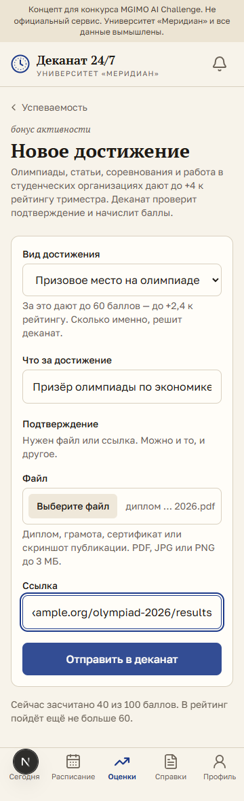 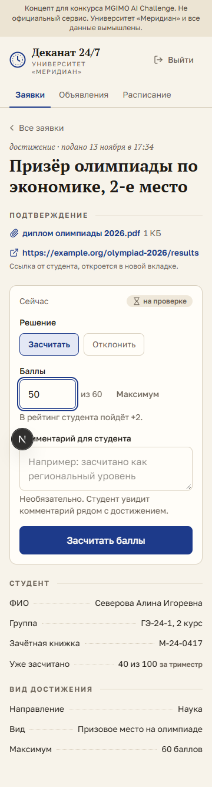 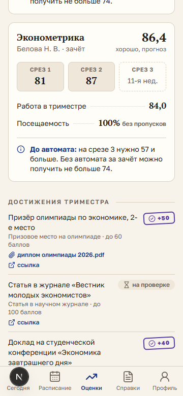

**Защита загрузки файлов.** Это первое место в прототипе, где пользователь отправляет файл, поэтому:
- тип определяется по первым байтам, а не по имени: страница с кодом под именем «диплом.pdf» не проходит;
- принимаются только PDF, PNG и JPEG до 3 МБ, имя очищается от пути и служебных символов;
- файл лежит в базе в отдельной таблице и отдаётся только хозяину и деканату; чужой id отвечает 404;
- ссылка-подтверждение — только http(s), `javascript:` не пройдёт;
- не больше 5 достижений в сутки от одного студента.

**Заодно исправлено по итогам проверки:**
- «Выйти на всех устройствах» в профиле: в PRD было, в кабинете не было;
- `/robots.txt` отвечал перенаправлением на вход, теперь открыт и запрещает индексацию;
- в справочник добавлен вид «Призовое место на олимпиаде» — именно его называет сценарий.

**Для жюри и автора:** [JURY.md](../JURY.md) — аккаунты и восемь сценариев по шагам, там же честный список того, что не вошло. [CHECKLIST.md](CHECKLIST.md) — что автор проверяет руками на сервере и с телефона.

**Как проверяли:** 169 юнит-тестов (23 новых: тип файла, имя, ссылка, пределы баллов), 20 сценариев Playwright (4 новых). Сценарий 6 проходится от подачи до роста рейтинга; студент, преподаватель и деканат не получают чужой файл. Новые экраны сняты на 360 px, горизонтальной прокрутки нет.

**Что пошло не так:**
1. **Лимит использования ИИ закончился посреди проверки.** Сессия оборвалась на списке находок, код не был затронут. После сброса лимита работа продолжилась с того же места.
2. **Локальная база зависла.** Процесс PostgreSQL остался от прошлой сессии и рвал соединения: сид падал с ECONNRESET. ИИ завершил оставшиеся процессы и запустил базу заново.
3. **Одно имя на два смысла.** В общей очереди ИИ пометил записи полем `kind`, а у достижения уже есть `kind` — вид достижения. Проверка типов поймала это до запуска.

**Не вошло, записано в JURY.md:** архив прошлых триместров, посещаемость и оценки сессии у преподавателя, у `teacher` одна группа.

**Вручную:** ничего. Проверка на сервере под входом — за автором, по чек-листу.

---

## Этап 19. Расхождения с PRD закрыты — 13.11.2026

**Промпт автора:** «Да, закрыть». После проверки оставались три расхождения между планом и прототипом. ИИ предложил решение по каждому, автор согласился на все три.

**1. `teacher` ведёт обе группы.** PRD обещал, что преподаватель ведёт группы обоих тестовых студентов, а логин был у преподавателя макроэкономики с одной группой. Логин `teacher` отдан преподавателю английского: он ведёт ГЭ-24-1 и МП-23-2. Сценарий 4 стал нагляднее: `student2` по английскому чуть-чуть не хватает до автомата, преподаватель ставит балл за третий срез — и автомат появляется на глазах.

**2. Блокировка входа.** Пять неверных паролей закрывали логин на 15 минут для всех. Логины демо общие, поэтому одна опечатка жюри или чужая попытка закрыла бы вход остальным. Теперь неудачи считаются по паре «логин + адрес»: пять неудач закрывают вход только этому адресу. От подбора с многих адресов остался общий предел — 30 неудач на логин, и 20 на адрес под любыми логинами. Правило вынесено в чистую функцию с тестами.

**3. PRD сверен с прототипом.** В PRD добавлен раздел 13: таблица «в плане — в прототипе» по всему, что не вошло или сделано уже. Таблица тестовых аккаунтов исправлена: у `student2` нет пересдачи, потому что сессия ещё не началась.

**Как проверяли:** 173 юнит-теста, 22 сценария Playwright. Новые: чужие неудачи под общим логином не мешают войти; пять своих неверных паролей закрывают вход даже с верным паролем; преподаватель видит обе группы, а студент после балла получает автомат.

**Что пошло не так:** ничего. Сид, тесты и документы поменялись согласованно с первого прогона.

**Вручную:** ничего.

---

## Этап 20. Первое впечатление: путеводитель, тема, движение, установка на телефон — 15.11.2026

**Промпт автора:** «Погоди, не торопись со сдачей. Давай подумаем, какие киллер-фичи и удобства можно сделать, чтобы взять призовое место». ИИ предложил четыре пакета и порядок. Первым взяли то, что жюри видит в первую минуту.

**Что появилось:**
- **«Путеводитель».** Кнопка внизу любой страницы. Внутри — «Смотреть как» (переход между студентами, преподавателем и деканатом в одно нажатие) и восемь сценариев по шагам. Путеводитель сам открывает нужную страницу и переключает на того, чья очередь: «Дальше — деканат» → «Продолжить как деканат». Раньше для сценариев с двумя участниками нужно было выходить и входить заново.
- **Сценарий 7 в два нажатия.** На странице заявки Алины кнопка «Открыть эту страницу как Матвей» — и сразу виден ответ «Такой страницы нет».
- **Тема.** Тёмная была и раньше, но включалась только вслед за системой. Теперь есть кнопка в шапке и выбор «светлая / тёмная / как в системе» в профиле. Выбор хранится в cookie, поэтому страница сразу приходит в нужной теме, без мигания.
- **Движение.** Печать «готово» ставится: падает с поворотом и чуть пружинит. Число рейтинга доезжает от прошлого значения к новому, рядом видна разница «▲ +2,0». Разделы плавно появляются при переходе. Всё выключается, если в системе включено «уменьшить движение».
- **Установка на телефон.** Манифест и значки: кабинет ставится на главный экран и открывается без адресной строки.
- **Вход.** Четыре карточки тестовых аккаунтов: нажатие подставляет логин.

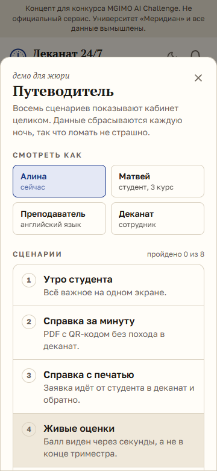 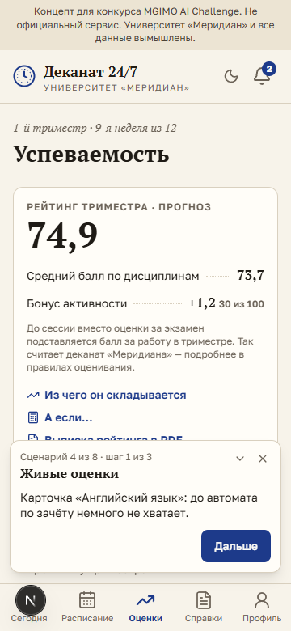 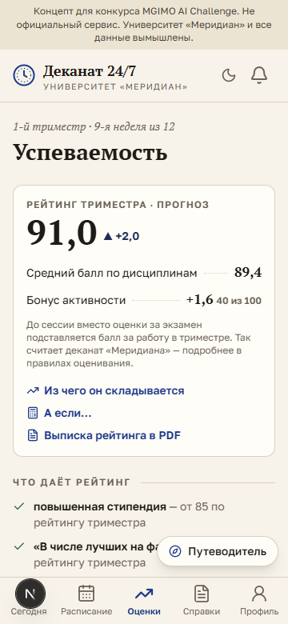 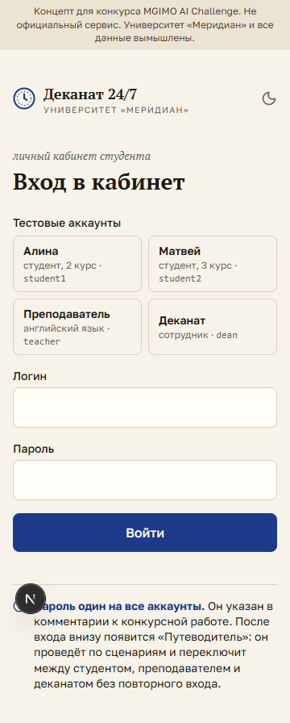

**Защита переключателя.** Переключение без пароля выглядит как дыра, поэтому правила жёсткие:
- перейти можно только между четырьмя демо-аккаунтами и только тому, кто сам вошёл под одним из них; пароль у них общий, так что прав это не добавляет;
- прежняя сессия удаляется, новая создаётся так же, как при обычном входе;
- адрес «куда перейти после» принимается только внутри сайта;
- под обычным аккаунтом путеводителя нет вообще — проверено тестом;
- выключается одной переменной окружения.

**Как проверяли:** 181 юнит-тест, 30 сценариев Playwright (8 новых): сценарий 3 проходится через путеводитель с тремя переключениями; сценарий 7 заканчивается страницей «не найдено»; тема сохраняется после перезагрузки и побеждает системную; манифест и значки открыты без входа. Экраны сняты на 360 px и на десктопе, в светлой и тёмной теме.

**Что пошло не так:**
1. **Рейтинг Алины на странице Матвея.** После переключения на той же странице число рейтинга осталось прежним — 91,0 вместо 74,9. Строки ниже были уже новые. Причина: компонент с анимацией хранил «показанное число» и не сбрасывал его при смене человека. ИИ увидел это на снимке экрана, а не в тестах: тесты читали правильное значение из атрибута. Теперь показанное число не хранится вне анимации, компонент пересоздаётся при смене аккаунта, и есть тест на видимый текст.
2. **Разница «+2,0» не появлялась в режиме разработки.** React в dev-режиме запускает эффекты дважды: первый запуск запоминал новое значение, второй уже не видел разницы. Теперь значение запоминается только когда анимация дошла до конца.
3. **Окно путеводителя не закрывалось** при переходе деканат → преподаватель: оба кабинета на одном адресе, страница не перезагружалась. Путеводитель пересоздаётся при смене аккаунта.
4. **Печать вращалась не туда.** В Tailwind 4 поворот задаётся свойством `rotate`, а анимация меняла `transform`: два поворота сложились бы. Анимация переписана на `rotate` и `scale`.
5. **Большая команда в терминале не выполнилась** из-за кавычек в тексте сценариев. Файлы созданы по одному.
6. **Значки не доехали до сервера.** Локально всё работало, а на сервере `/icons/icon-192.png` отвечал 404: папка `public` не копировалась в образ. ИИ заметил это, проверяя адреса после выкатки, и добавил копирование в Dockerfile. Тесты этого не ловят: они идут против локального сервера разработки.

**Вручную:** ничего.

---

## Этап 21. Механики: «Путь к цели», светофор, сводка деканата — 15.11.2026

**Промпт автора:** «Да, дальше. В хроме я зашел в акк студента». Второй пакет из списка идей: то, чего нет в обычном личном кабинете.

**Сначала проверка на сервере.** Автор вошёл в Chrome под студентом, и ИИ через расширение впервые посмотрел сервер под входом: открыл «Оценки», запустил сценарий в путеводителе, переключился на Матвея и обратно. Рейтинг сменился с 91,0 на 74,9, путеводитель и тёмная тема работают.

**Что появилось:**
- **«Путь к цели».** Студент выбирает цель — стипендию, грант, отметку «в числе лучших». Кабинет сам считает:
  - *ровный план* — на сколько баллов выше нынешнего среднего нужно получать на всём, что осталось, с числом по каждой дисциплине;
  - *один сильный ход* — отдельные способы, которых хватает в одиночку: «Международные финансы: экзамен — 91 и больше», с пометкой «по силам», «с усилием» или «на пределе»;
  - если цель уже взята — *запас*: на сколько можно опуститься и не потерять её;
  - если не дотянуть — честно: «даже с сотнями выйдет меньше порога».
  Калькулятор «А если…» отвечает на вопрос «что будет, если». Здесь кабинет отвечает на вопрос «что делать».
- **Светофор по дисциплинам.** Пометка «спокойно», «обрати внимание» или «нужен план» и причина словами: «До „удовлетворительно“ всего 0,4 балла: один слабый срез — и оценка ниже». В PRD это было обязательным пунктом и до сих пор не было сделано.
- **Сводка деканата.** Главное число — сколько походов в деканат не понадобилось: по 3 за справку, выданную сразу, и по 2 за заявку с печатью. Рядом — сколько справок выдано без сотрудника, среднее время до «готово», что заказывают чаще всего. Это метрика «3 визита → 0» из PRD, посчитанная по данным.

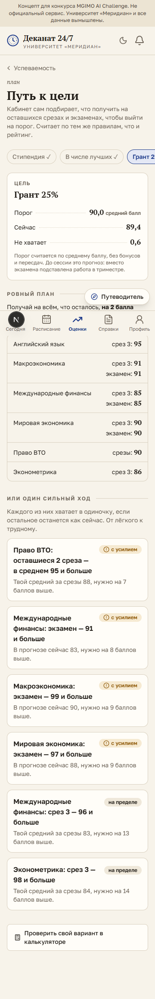 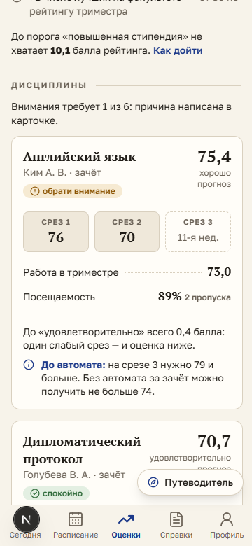 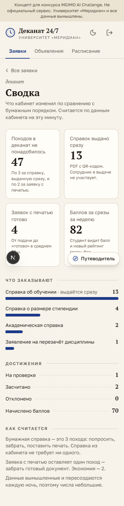

**Что сделали в коде:**
- `pathToGoal` — чистая функция поверх того же расчёта, что рейтинг и калькулятор. Перебирает целые баллы от 0 до 100 и берёт наименьший, которого хватает: формул «в обратную сторону» нет, поэтому план не может разойтись с рейтингом.
- В сид добавлена история: справки и заявления одногруппников за прошлые недели. Без неё сводка показывала «9 походов», и кабинет выглядел так, будто им пользуются два человека. Рейтинги тестовых студентов не изменились: у истории свой генератор случайных чисел.
- В сценарий 5 путеводителя добавлен шаг «Путь к цели».

**Как проверяли:** 199 юнит-тестов (18 новых), 35 сценариев Playwright (5 новых). Главный тест: число из плана («экзамен — N и больше») вводится в калькулятор. С N цель появляется, с N − 1 — нет. Число походов в сводке сверяется с базой. Сводка закрыта для преподавателя и студента.

**Что пошло не так:**
1. **«Достижения — ещё 253 балла».** Для далёкой цели план предлагал набрать больше баллов, чем разрешено за триместр. Теперь, если хода не хватает, написано, сколько он даст: «все оставшиеся 70 баллов дадут +2,8 из нужных 10,1».
2. **«В среднем меньше часа» при нуле готовых заявок.** Среднее время считалось и по справкам, которые выдаются сразу. Теперь — только по заявкам, которые ведёт деканат.
3. **Шапка сотрудника вылезла на 1 пиксель** на 360 px: рядом встали логотип, кнопка темы и «Выйти». На телефоне у кнопки выхода остался значок. Нашлось проверкой ширины страницы, на снимке это не видно.
4. **Длинное название дисциплины** «Теория международных отношений» наезжало на оценку справа. Заголовок теперь переносится, а «прогноз» стоит отдельной строкой.

**Вручную:** автор вошёл в Chrome под студентом, чтобы ИИ мог проверить сервер под входом.

---

## Этап 22. Обзор оформления: от «кремовой бумаги» к бланку с печатью — 15.11.2026

**Промпт автора:** «У меня есть ощущение, что оформление сайта, наверное, твоё ИИшное базовое. Я установил новые скиллы на оформление и дизайн, твоя задача ещё раз просмотреть оформление и дизайн и улучшить, где надо».

**Автор оказался прав.** ИИ прогнал интерфейс через шесть скиллов (доступность, вёрстка, тексты, типографика, цвет, детали) и сверил с перечнем признаков «сгенерированного» оформления. Совпало почти всё:
- кремовый фон `#f7f3ea` с контрастным шрифтом с засечками — самый частый признак;
- подписи КАПИТЕЛЬЮ с разрядкой над каждым блоком;
- курсивная строка над каждым заголовком, которая просто называла раздел ещё раз: «профиль», «калькулятор», «план»;
- одно скругление 12 px на всём подряд, от карточки до поля;
- плавное появление страницы при каждом переходе — его ИИ сам добавил на этапе 20.

Концепция «Зачётка» выбрана автором и привязана к теме, поэтому она осталась. Изменилось исполнение: вместо «тёплой бумаги вообще» — конкретный предмет, бланк деканата.

**Что изменилось:**
- **Бумага.** Холодноватая, как у ведомости, вместо кремовой. Чернила по-прежнему синие, печать фиолетовая. Тёмная тема — иссиня-чёрная вместо коричневой.
- **Круглая печать деканата** — главный знак кабинета. Надпись по кругу, слово решения в центре, неровные чернила, лёгкий наклон. Стоит на углу листа там, где решение окончательно: справка готова, справка подлинная, достижение засчитано. Одна на экран. В списках остался маленький прямоугольный штамп.
- **Углы.** Лист и поля — 6 px, как у бумаги. Круглыми остались только счётчики, аватар и плавающая кнопка. Пометки о статусе и фильтры стали прямоугольными.
- **Подписи.** Заголовки разделов — обычным регистром с линейкой, как графа в бланке. Подписи внутри листа — мелким курсивом, как «(подпись)» под строкой. Строка над заголовком осталась только там, где сообщает дату, номер или срок.
- **Движение.** Переходы между разделами мгновенные. Остались три осмысленных момента: печать ставится, новое число подсвечивается, окно путеводителя выезжает. У кнопки появилось нажатие.

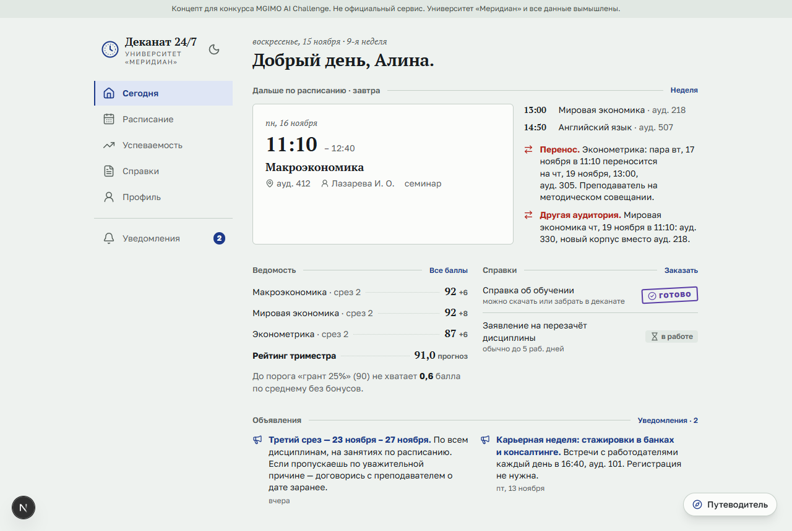 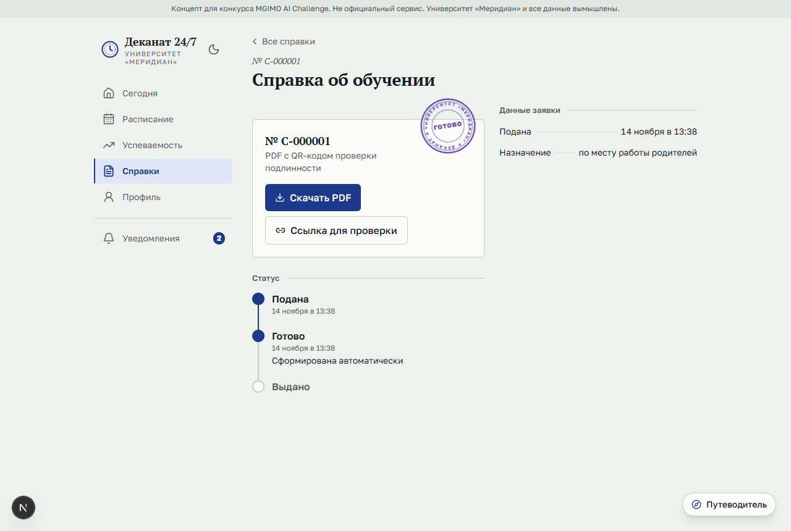 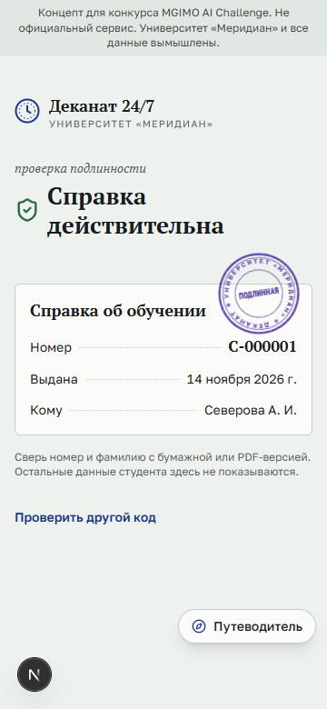

**Что нашёл обзор по правилам, а не по вкусу:**

| Важность | Что | Было | Стало |
|---|---|---|---|
| Высокая | «Уведомления» на 320 px прокручивались вбок на 90 px | скрытый текст счётчика в фильтрах раздвигал страницу | ряд фильтров удерживает его внутри; тест на 320 px по семи экранам |
| Высокая | Граница полей ввода почти не видна | контраст 1,5 при нужных 3 | отдельный токен границы поля, 3,5 в светлой теме и 4,1 в тёмной |
| Средняя | У полей в фокусе не было кольца | `outline-none`, менялся только цвет тонкой рамки | обычное кольцо фокуса; тест |
| Средняя | С клавиатуры нельзя пропустить меню | — | ссылка «Перейти к содержимому» первой остановкой |
| Средняя | Элемент в фокусе мог оказаться под нижней панелью | — | отступ прокрутки под панель |
| Средняя | Смена темы «размазывалась» | у кнопок был плавный переход цвета | на кадр смены темы переходы выключаются |
| Низкая | Длинные подсказки на всю ширину экрана | больше 100 знаков в строке | не длиннее 65 |
| Низкая | Одно слово на последней строке заголовка, предлог в конце строки | — | балансировка переносов |
| Низкая | Пустое состояние: значок в цветном кружке | шаблонный приём | значок без подложки |

Текст на всех фонах проходил по контрасту и раньше (от 4,9), это посчитано скриптом для 19 пар в обеих темах.

**Как проверяли:** 199 юнит-тестов, 37 сценариев Playwright (2 новых: ширина 320 px и клавиатура). Все экраны сняты на 360 px и на десктопе в обеих темах.

**Не проверено:** проход с экранным диктором, масштаб 200%, наведение и нажатие каждой кнопки глазами.

**Что пошло не так:**
1. **Локальная база зависла во второй раз** после обрыва сессии: вход отдавал «Не получилось загрузить». ИИ сначала искал ошибку в своих правках, потом увидел в логе сервера, что падает запрос к базе.
2. **Два теста искали слово «выдано» и «подлинная» текстом.** Теперь это круглая печать, тесты ищут её по подписи для экранного диктора.
3. **Тест «уведомление без перезагрузки» гонялся с первым опросом** и упал, когда страница стала отвечать быстрее. Тест теперь ждёт первый опрос.

**Вручную:** ничего. Автор установил скиллы оформления.

---

## Этап 23. Обложка зачётки: логотип, боковая панель, вход — 15–16.11.2026

**Промпт автора:** «Давай сделаем общее оформление более интересным, сделаем логотип, боковые панели и т. д.»

После этапа 22 кабинет перестал выглядеть шаблонно, но оставался плоским: лист на листе. Не хватало второго материала. У зачётной книжки он есть — тёмно-синий переплёт. Он и стал главным ходом.

**Что появилось:**
- **Знак.** Печать, в которой стрелки часов сложились в галочку: кольцо и двенадцать точек — оттиск печати и часовые отметки, стрелки на «десять минут одиннадцатого» — «круглосуточно» и «готово» сразу. Прежний знак был просто циферблатом. Значок вкладки и значки для телефона перерисованы из нового знака тем же скриптом.
- **Обложка.** На широком экране слева тёмно-синяя панель во всю высоту, как переплёт зачётки. На ней:
  - «титульный лист»: чей это кабинет — имя, группа и курс, номер зачётки; у сотрудника — должность;
  - разделы. Активный выглядит как бумажная закладка: того же цвета, что страница, и доходит до края панели, будто лист выглядывает из-под обложки;
  - внизу — тема и выход. Раньше выйти на широком экране можно было только из «Профиля».
- **Панель сотрудника.** Та же обложка. У деканата в ней появился четвёртый раздел — «Сводка»: во вкладках на телефоне он не помещался.
- **Телефон.** Сверху узкая полоса обложки со знаком, вкладки внизу остались.
- **Вход.** Слева обложка с тиснёной рамкой, крупным знаком и фразой из PRD: «Ни одного лишнего похода в деканат и ни одной оценки, о которой узнаёшь в конце триместра». Справа форма.

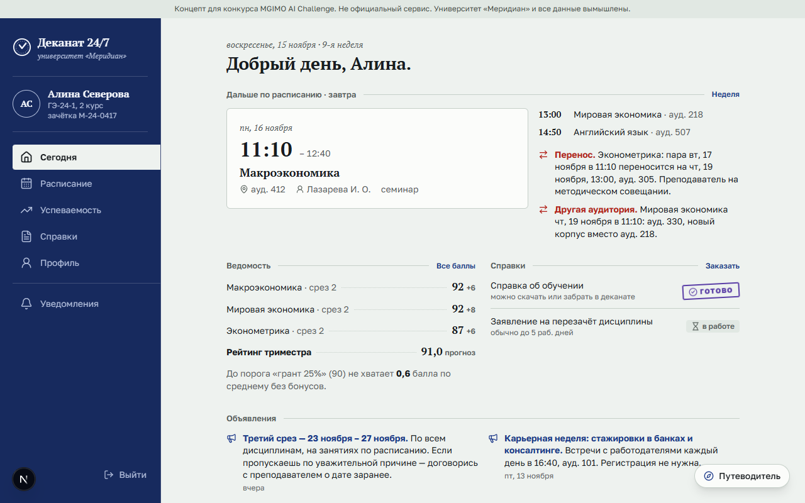 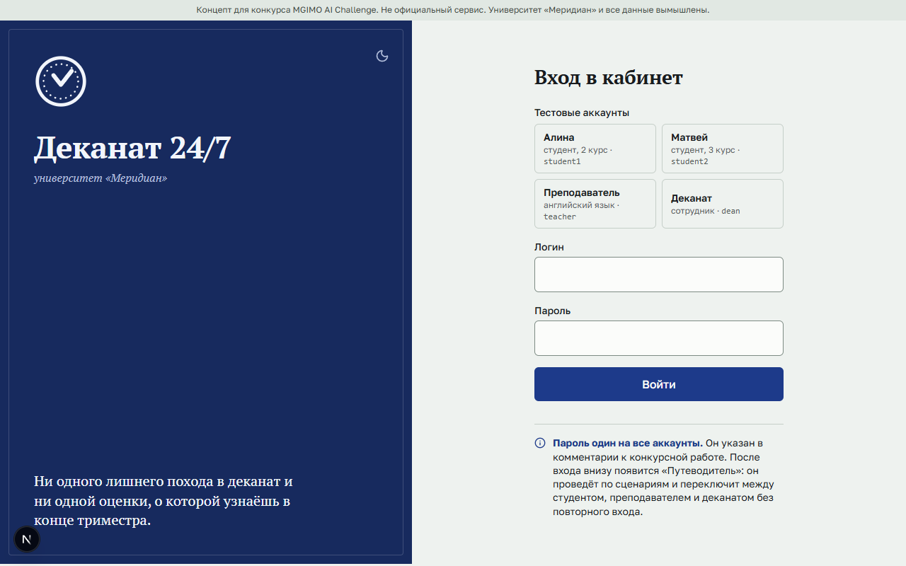 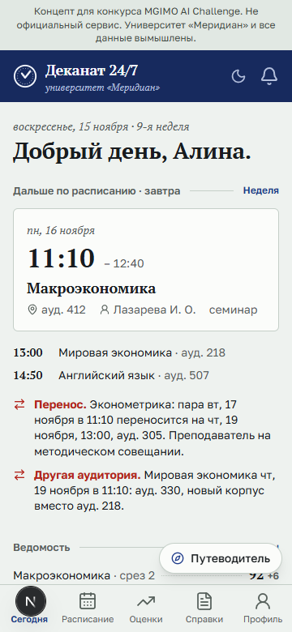 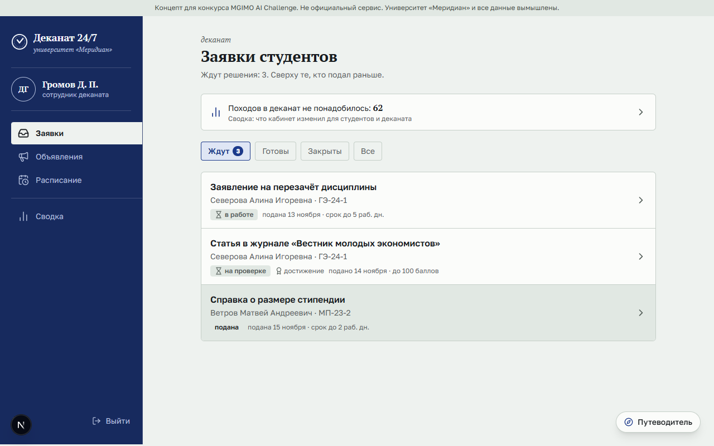

**Что учли:**
- Контраст на обложке посчитан: основной текст 12,6, второстепенный 7,5 в светлой теме; 14,0 и 7,4 в тёмной.
- Синее кольцо фокуса на синей обложке не видно, поэтому там оно бумажного цвета.
- В тёмной теме обложка почти сливается со страницей по яркости (1,1), поэтому у неё есть линия по краю и она заметно синее.
- Ширина 320 и 360 px проверена: ничего не прокручивается вбок.

**Как проверяли:** 199 юнит-тестов, 37 сценариев Playwright — все прошли на новом макете без правок. Экраны сняты на десктопе и телефоне в обеих темах.

**Что пошло не так:**
1. **Знак в мелком размере читался как обычная «галочка в кружке».** Точки внутреннего кольца были слишком мелкими и пропадали. ИИ увидел это на снимке и сделал их двенадцатью заметными часовыми отметками.
2. **Лимит использования закончился перед выкаткой.** Код был отправлен в репозиторий, а на сервер попал после сброса лимита, на следующий день.

**Не проверено:** сервер под входом после выкатки — ночной сброс данных завершил сеанс автора в Chrome.

**Вручную:** ничего.

---

## Этап 24. Архив прошлых триместров и годовой рейтинг — 16.11.2026

**Промпт автора:** «Да, архив» — в ответ на предложение продолжить пакетами с архива и годового рейтинга.

Это был единственный пункт P0 из PRD, которого не было: в данных жил один текущий триместр, а годовой рейтинг считался по нему одному.

**Что появилось:**
- **Прошлые триместры в данных.** У Алины позади первый курс, у Матвея — два. По каждой дисциплине выставлены срезы, сессия, посещаемость и активность, засчитаны достижения. Числа подобраны под историю: у Алины годовой рейтинг 89,6, до гранта 25% не хватило 0,4. У Матвея одна пересдача: 74 на экзамене превратились в 64, а стипендии за тот триместр нет.
- **Экран «Архив и годовой рейтинг».** По годам: годовой рейтинг крупно, у текущего года — прогноз, график среднего балла по трём триместрам, сколько не хватило до гранта. В строке триместра — средний балл, бонус, отметки «повышенная стипендия» и «пересдача».
- **Закрытый триместр.** Каждая дисциплина по частям: работа в триместре, сессия словами («автомат», «экзамен: 74 − 10 за пересдачу»), вовлечённость с посещаемостью. Ниже — засчитанные достижения.
- **Выписка рейтинга в PDF** теперь показывает и годовые рейтинги, как обещает её описание.
- **Путеводитель:** в сценарии «Успеваемость» новый шаг с архивом.

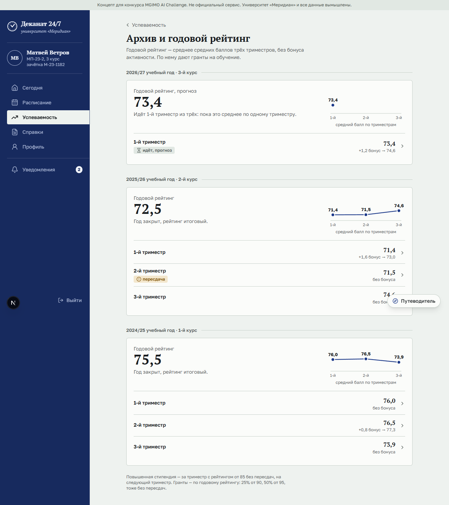 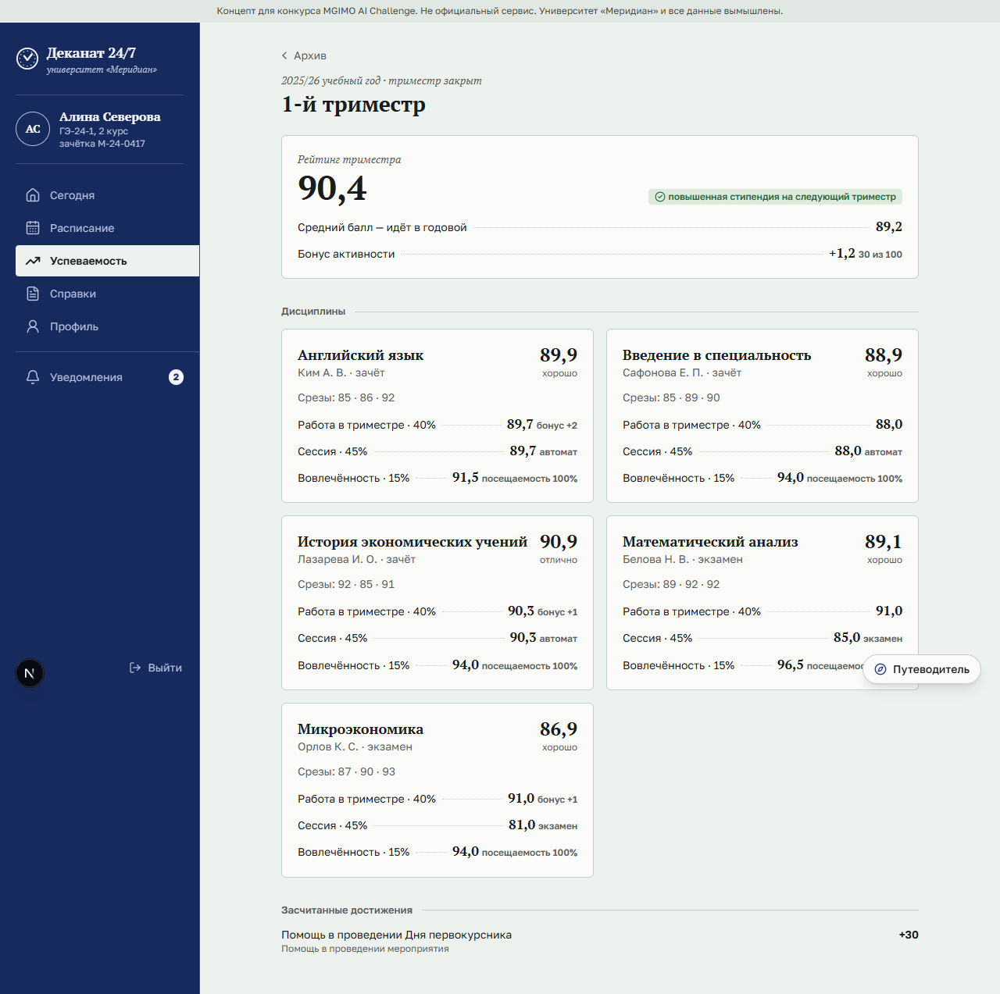

**Что учли:**
- Триместр берётся из адреса, поэтому архив открывает только триместры, в которых училась группа студента. Чужой, несуществующий или «мусорный» адрес — 404, текущий триместр ведёт на «Успеваемость». Тест повторяет это в браузере.
- **Нашлась дыра у преподавателя.** Журнал курса открывался по id без проверки триместра: по прямой ссылке можно было переписать оценки прошлого года. Теперь журнал есть только у курсов текущего триместра, и это тоже проверяет тест.
- Годовой рейтинг — среднее средних баллов без бонуса, как в правилах оценивания. Пока год не закрыт, он подписан как прогноз.
- Разница «до гранта» считается от числа на экране: 90 − 89,6 = 0,4, а не 0,45.

**Как проверяли:** 212 юнит-тестов (9 новых — годовой рейтинг, гранты, стипендия, учебный год по дате), 41 сценарий Playwright (4 новых), lint, сборка. Экран проверен на 360 px: вбок не прокручивается.

**Что пошло не так:**
1. **Чужой триместр отвечал кодом 200.** Страница «не найдено» показывалась, но заглушка загрузки раздела «Успеваемость» уже начинала потоковую отдачу со статусом 200. Заглушки перенесены в группы маршрутов, чтобы они не накрывали вложенные страницы.
2. **Упал старый тест светофора.** Посещаемость в демо считается по прошедшим дням текущей недели, и в понедельник десятые балла другие, чем в субботу. Тест теперь проверяет смысл, а не точные десятые.

**Вручную:** ничего.

---

## Этап 25. Место на курсе без фамилий — 16.11.2026

**Промпт автора:** «Да, дальше» — следующий пакет из списка: место в группе без фамилий.

В PRD это P2: «место на курсе видно только самому студенту, без публичных списков с ФИО». В вузах сейчас такие списки часто висят целиком, с фамилиями и баллами.

**Что появилось:**
- **Блок «Место на курсе» в «Успеваемости».** Место крупно, «из 9 на 2-м курсе», «рейтинг выше, чем у 57% курса». Рядом столбики: сколько человек в каждом диапазоне рейтинга по 5 баллов, свой столбик отмечен «ты».
- **Место в выписке рейтинга PDF** — как обещал пункт PRD про выписки «с местом на курсе».
- В данных у одногруппников появился свой уровень. Раньше их средние по шести дисциплинам сливались в один диапазон, и график показывал толпу в одной точке.

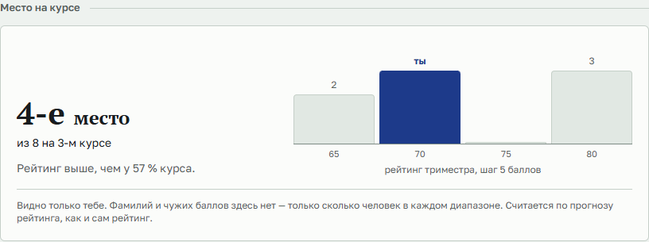

**Что учли:**
- Чужие рейтинги считаются на сервере и наружу не выходят: в ответе только место, число студентов и счётчики по диапазонам. Ни id, ни ФИО, ни чужих баллов. Тест проверяет, что на странице нет фамилий одногруппников, а счётчики диапазонов в сумме дают весь курс.
- Если на курсе меньше пяти человек, место не показывается: по диапазонам можно было бы угадать чужие баллы.
- Равные рейтинги, одинаковые до десятой, делят место — так, как числа видны на экране.
- Для экранного диктора у каждого столбика есть подпись словами: «70–75: 2 студента, ты здесь».

**Как проверяли:** 218 юнит-тестов (4 новых — место, ничьи, маленькая группа, диапазоны), 43 сценария Playwright (2 новых), lint, проверка типов. Блок снят на 1280 и 360 px.

**Что пошло не так:** один раз при полном прогоне упал тест путеводителя (сценарий 7), отдельно и при повторном полном прогоне он прошёл. Похоже на гонку по времени. Пока не исправлено, тест под наблюдением. *Дополнение 18.11 (этап 29):* 12 повторов в три потока не воспроизвели падение, а тесты и так идут в один поток. Вероятная причина — первая сборка страницы dev-сервером после правок кода, она дольше стандартных 5 секунд ожидания. Ожидание проверок в Playwright подняли до 10 секунд.

**Вручную:** ничего.

---

## Этап 26. Электронный студенческий с QR — 16.11.2026

**Промпт автора:** «Да, дальше» — следующий пакет: электронный студенческий с QR.

Пластиковый студенческий теряют, забывают дома и неделями ждут замену в деканате. А на входе, в библиотеке и в музее его просят каждый день.

**Что появилось:**
- **«Профиль» → «Электронный студенческий».** Карточка в цвете обложки зачётки: ФИО, факультет, курс и группа, номер зачётки, срок действия (до 31 августа конца учебного года). QR-код стоит сразу под именем, чтобы на телефоне был виден без прокрутки.
- **QR меняется каждую минуту и живёт две.** Снимок экрана, пересланный другу, через пару минут показывает «QR-код устарел», а ещё через две — «код не найден». Пока карточка открыта, экран не гаснет (если браузер это умеет).
- **Публичная проверка без входа.** Охранник сканирует QR и видит фамилию с инициалами, факультет, курс, срок и печать «действует». Имени полностью и номера зачётки там нет.
- **Путеводитель:** шаг в сценарии 8 «Проверка справки».

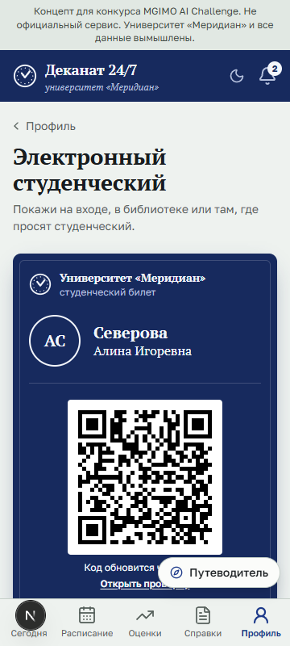 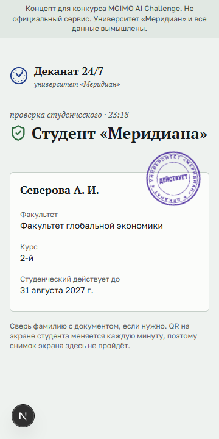

**Что учли:**
- Код случайный, 128 бит, по нему нельзя узнать id студента. Подписывать коды секретным ключом не пришлось: они хранятся в базе со сроком, поэтому в коде и настройках нет нового секрета.
- Старые коды удаляются, когда студент берёт новый: таблица не растёт.
- Больше 20 кодов в минуту одному студенту не выдаётся — защита от обновления в цикле.
- Отсчёт «Код обновится через N с» экранный диктор не читает каждую секунду. Вслух — только если пропала связь и код устаревает.
- QR чёрный по белому при любой теме: так его читают все сканеры.

**Как проверяли:** 227 юнит-тестов, 46 сценариев Playwright (3 новых: проверка без входа и без лишних данных; устаревший, мусорный и неизвестный код; новый код через минуту на ускоренных часах), lint, сборка. Снято на 360 px в обеих темах.

**Что пошло не так:**
1. **Ошибка гидратации.** Отсчёт до обновления считался и на сервере, и в браузере, и секунды расходились. Теперь время берётся только в браузере.
2. **Тест обновления падал через раз.** Ускоренные часы в браузере стартуют до входа, а код выдаётся позже, и 61 секунды не хватало. Взяли с запасом. Заодно оказалось, что лимит «6 кодов в минуту» срабатывает на нескольких прогонах подряд — подняли до 20.

**Вручную:** ничего.

## Этап 27. Расписание в календаре телефона — 18.11.2026

**Промпт автора:** «Да, дальше» — следующий пакет: расписание в календарь (.ics).

Расписание смотрят в календаре телефона, рядом со всем остальным. Обычно его туда переносят руками, а про перенос пары узнают уже у закрытой аудитории.

**Что появилось:**
- **«Расписание» → «В календарь на телефоне».** Кнопка «Подписаться» открывает подписку на iPhone и Mac, кнопка «Google Календарь» — в Google. Для Яндекса и Outlook — ссылка, которую можно скопировать.
- **В календаре все пары триместра.** Перенесённая пара переезжает на новое время, а не раздваивается. Отменённая остаётся с пометкой «Отменено» и причиной. На неделе среза первая пара дисциплины подписана «Срез N». Календарь перечитывает ленту несколько раз в день.
- **«Скачать .ics»** — тот же файл, но один раз и без обновлений.
- **Сброс ссылки.** Если ссылка ушла не тому, её можно заменить: старая сразу отвечает «не найдено».

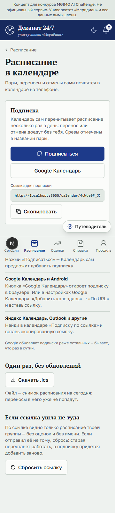 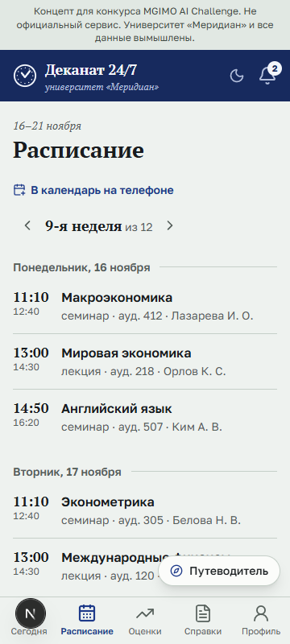

**Что учли:**
- Календарь забирает ленту сам и войти не может, поэтому ссылка секретная: случайный код на 128 бит. В ленте только расписание группы, без оценок и без имени студента.
- Формат по RFC 5545: время в UTC, экранирование, строки сворачиваются по 75 байт. Считаются байты, а не буквы: кириллица занимает по два, и резать букву пополам нельзя.
- Ночной пересев демо-данных не ломает подписки: ссылки студентов переносятся в новые данные.
- Заглушка загрузки недели расписания уехала в группу маршрутов, чтобы не показываться на странице календаря.

**Как проверяли:** 244 юнит-теста (17 новых — сборщик .ics: экранирование, свёртка, перенос, отмена, срез, UTC), 49 сценариев Playwright, из них 3 новых (лента по ссылке без входа и без имени; у второго студента своя лента, после сброса старая ссылка — 404; мусорные ссылки — 404, а не страница входа), lint, сборка. Снято на 360 px.

**Что пошло не так:**
1. **Поле ссылки на 360 px сжималось до «http://localhos».** Кнопку «Скопировать» перенесли под поле.

**Вручную:** подписаться в Google Календаре и на iPhone можно только на проде: локальный адрес календарям недоступен.

## Этап 28. Версия для слабовидящих — 18.11.2026

**Промпт автора:** «Да, дальше» — следующий пакет: версия для слабовидящих.

У сайтов университетов в России есть «версия для слабовидящих» (ГОСТ Р 52872). Кабинет студента — тот же сайт вуза, и человеку с плохим зрением он нужен не меньше.

**Что появилось:**
- **Значок с глазом в шапке**, в том числе на странице входа. Включает крупный шрифт и схему «чёрным по белому» и сразу открывает настройки.
- **Панель настроек над страницей:**
  - размер шрифта: обычный, крупный (125%), очень крупный (150%);
  - цвета: как в теме, «чёрным по белому», «белым по чёрному», «синим по голубому»;
  - интервалы: обычные или увеличенные, по WCAG 1.4.12;
  - «Обычная версия» — выход.
- **Без анимаций и с толстой рамкой фокуса**, пока версия включена.
- **Выбор хранится в cookie**, как тема: сервер сразу отдаёт страницу крупной, без мигания, и после входа ничего не сбрасывается.

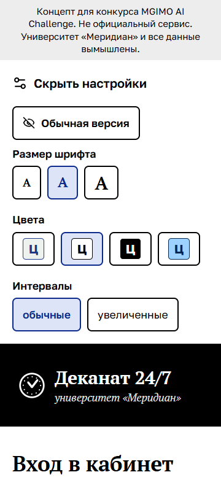 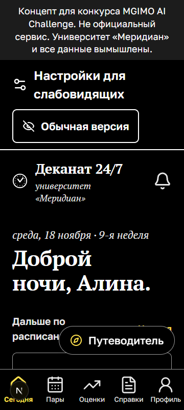 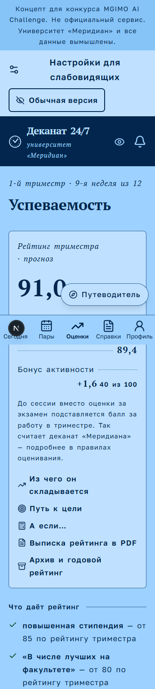

**Что учли:**
- Контраст основного текста к фону в каждой схеме не ниже 7:1 (AAA): «чёрным по белому» — 21:1, «белым по чёрному» — 21:1, «синим по голубому» — 9,4:1. Цвета «готово», «внимание» и «ошибка» на своих подложках — тоже от 7:1.
- Крупные заголовки и числа были заданы в пикселях и не росли вместе со шрифтом. Перевели их в rem — заодно они теперь растут и от настройки размера шрифта в самом браузере.
- На вкладку внизу приходится около 70 px, и «Расписание» крупным шрифтом туда не влезает. В этой версии вкладка подписана «Пары».

**Как проверяли:** 248 юнит-тестов (4 новых — разбор cookie: мусор в cookie даёт обычную версию), 51 сценарий Playwright, из них 2 новых на 360 px: включение на странице входа, смена шрифта, цвета и интервалов, вход с сохранением настроек, отсутствие прокрутки вбок на четырёх разделах, «Обычная версия» и мусорная cookie. Отдельным скриптом прошли все разделы студента, преподавателя и деканата и публичные страницы при 150% и увеличенных интервалах: ни одна не уезжает вбок.

**Что пошло не так:**
1. **На 150% страница «Оценки» становилась шире экрана.** Причин было три:
   - сетка карточек без явной колонки растягивалась под самое длинное слово;
   - значение в строке ведомости не переносилось;
   - метка статуса была запрещена к переносу.
   
   Теперь в этой версии длинные слова переносятся, а строка ведомости уводит значение на следующую строку.
2. **Первый вариант панели на телефоне ломался:** «Обычная версия» наезжала на «Настройки», а кнопки выбора выстраивались столбиком. Переделали: кнопка «Настройки» раскрывает панель под собой на всю ширину.
3. **Подписи вкладок рвались посреди слова** («Сегодн-я»). При «очень крупном» подписи вкладок остаются на уровне «крупного», зато значки над ними большие.

**Вручную:** ничего.

## Этап 29. Посещаемость у преподавателя — 18.11.2026

**Промпт автора:** «Продолжай делать всё в том же духе» — следующий пакет из списка: посещаемость у преподавателя.

Посещаемость входит в балл дисциплины, а студент видит пропуски в расписании. Но до этого этапа отметки брались только из исходных данных: преподаватель поставить их не мог.

**Что появилось:**
- **У курса два раздела:** «Баллы за срезы» и «Посещаемость».
- **Посещаемость пары.** Список прошедших пар курса: сегодняшняя появляется, как только началась. У каждой пары видно, сколько студентов без отметки.
  - У каждого студента три кнопки: «был», «пропуск», «уважит.» и число пропусков за триместр.
  - «Остальные были» отмечает всех, у кого ещё нет отметки, и не трогает тех, кого отметили руками.
- **На главной преподавателя** под каждым курсом строка: последняя пара и отмечена ли она. Это напоминание и короткий путь к отметкам.
- **Студент** получает уведомление о новом пропуске. Пропуск сразу виден в расписании и в балле дисциплины.
- **Путеводитель:** шаг в сценарии 4 «Живые оценки».

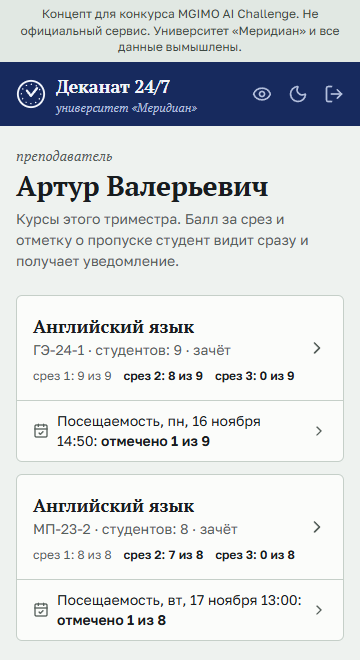 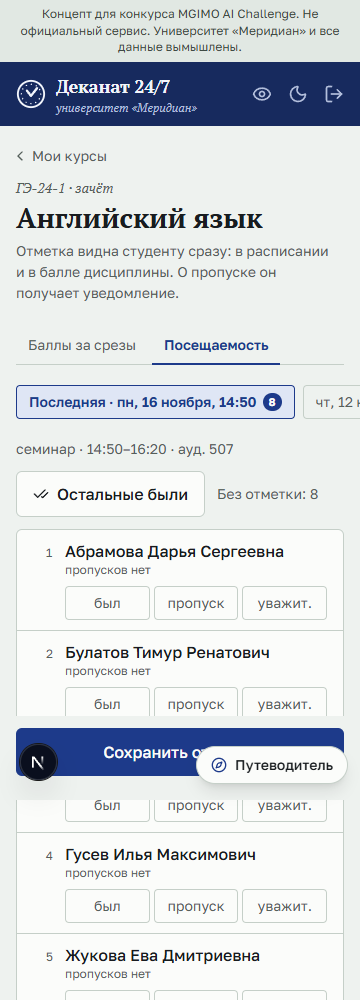

**Что учли:**
- Отметить можно только пару своего курса текущего триместра, которая уже началась и не отменена. Перенесённая пара отмечается в новый день. Чужой курс — 404, как у журнала баллов. Пара из будущего или мусор в адресе — показывается последняя пара, а сохранить такую отметку слой данных не даст.
- Отметки ставятся только студентам группы этого курса: чужие id молча отбрасываются.
- Уведомление приходит только о пропуске: «был» и «уважительная» студенту хуже не делают, и лишние уведомления ему не нужны.
- Пропуск — жёлтым «внимание», а не красным: красный в кабинете только для ошибок и переносов.

**Как проверяли:** 255 юнит-тестов и 54 сценария Playwright. Новые юнит-тесты — 3 (какие пары уже начались: отменённые не попадают, перенесённые — в новый день, до начала триместра пар нет). Новые сценарии — 3:
- пропуск доходит до студента уведомлением, отметка возвращается как была;
- «Остальные были» не трогает поставленные руками;
- чужой курс — 404, мусорная и будущая пара — последняя.

Снято на 360 px.

**Что пошло не так:**
1. **На телефоне кнопки «был / пропуск / уважит.» наезжали на имя.** Имя сжималось вместо того, чтобы кнопки уходили на следующую строку. Теперь на телефоне кнопки стоят под именем на всю ширину.

**Вручную:** ничего.

---

## Этап 30. PDF «Как создавался проект» — 18.11.2026

**Промпт автора:** «Продолжай делать всё в том же духе» — следующий пакет: заготовка PDF для жюри (PRD §10.3).

**Что сделали:** скрипт `npm run report` сам собирает PDF из документов репозитория, без ручного копирования:
- проблема — раздел 2 PRD;
- опрос — `docs/research/survey.md` (пока там вопросы и заглушка вместо результатов);
- ИИ-инструменты и все этапы с промптами, ошибками и скриншотами — этот журнал;
- вход и защита — раздел «Безопасность» из ARCHITECTURE.md;
- «что сделано вручную» — строки «Вручную» всех этапов, пустые («ничего») пропускаются.

Обложка с плашкой «концепт», содержание со списком этапов, номера страниц. Шрифты те же, что в кабинете (Golos Text и PT Serif из Fontsource), PDF печатает тот же Chrome, что гоняет e2e-тесты. Markdown превращает в HTML библиотека `marked` (MIT, записана в лицензии README).

**Что пошло не так:**
1. **tsx собирает скрипты в CommonJS**, а там нет `await` верхнего уровня. Запуск завернули в `main()`.
2. **В «Вручную» попадал разделитель `---`** следующего этапа, и фильтр «ничего» не срабатывал. Теперь текст обрезается на разделителе.

**Осталось автору:** собрать ответы опроса, вписать их в `docs/research/survey.md` и запустить `npm run report` ещё раз.

**Вручную:** ничего.

---

## Этап 31. Объявления: исправить и снять — 18.11.2026

**Промпт автора:** «Продолжай делать всё в том же духе» — следующий пакет из сверки PRD (раздел 13): у деканата опубликованное объявление нельзя было ни поправить, ни убрать.

**Что появилось:** у каждого опубликованного объявления две кнопки.
- **«Исправить»** открывает форму прямо в списке. Новый заголовок и текст видны студентам на главной с пометкой «изменено». Уведомления, которые уже пришли, тоже показывают новый текст. Повторного уведомления нет: это опечатка, а не новость.
- **«Снять»** работает в два шага, с предупреждением, что вернуть нельзя. Объявление пропадает у студентов вместе с уведомлениями. У деканата оно остаётся зачёркнутым с пометкой «снято» и временем.

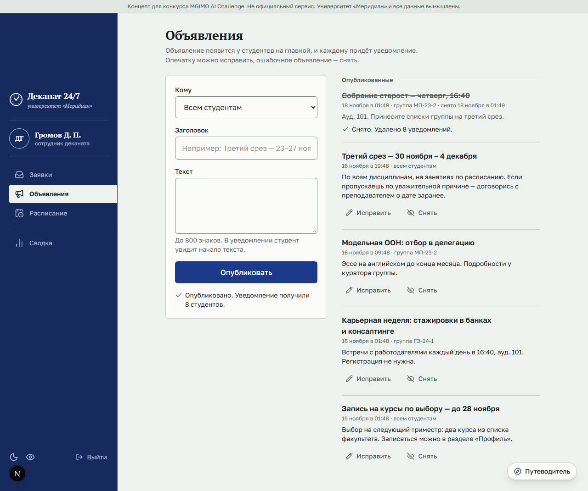 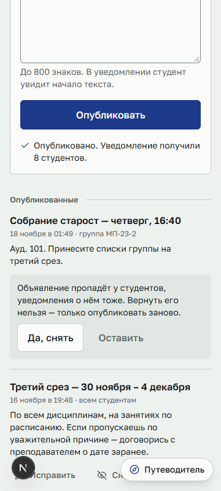

**Как устроено:** у уведомления появилась ссылка на объявление (`announcement_id`, миграция 0007). По ней правка меняет текст уведомлений, а снятие их удаляет. Сид связывает с объявлениями и демо-уведомления. Править и снимать может только роль деканата: это проверяет слой данных, а не кнопки.

**Как проверили:** новый e2e-тест. Деканат публикует для группы, исправляет — студент видит новый текст на главной и в уведомлениях. Затем снимает: «Удалено 8 уведомлений», у студента пусто и там и там.

**Что пошло не так:** старый тест публикации искал единственную область статуса на странице. Теперь у каждого объявления своя, и тест ищет статус внутри формы «Новое объявление».

**Вручную:** ничего.

---

## Этап 32. «Спроси деканат» без ИИ — 18.11.2026

**Промпт автора:** «Продолжай делать всё в том же духе» — следующий пакет из сверки PRD: строка «Спроси деканат» (P2).

**Решение ИИ:** подключать ИИ-провайдера ночью без автора не стали. Нужен ключ, оплата и решение, какие данные студента можно отправлять наружу, — это решает автор. В PRD §5.8 уже есть запасной режим: «если ИИ недоступен, строка работает как обычный поиск по разделам». Его и сделали, только умнее простого поиска. Вопрос разбирается по ключевым словам, и строка ведёт к действию, как и обещано в PRD.

**Что появилось:** страница «Спроси деканат». Значок с вопросом в шапке телефона и пункт на обложке на широком экране.
- **«нужна справка в военкомат»** → карточка справки об обучении и кнопка «Открыть заполненную форму»: в форме назначение уже выбрано. Так же понимаются виза, банк, соцзащита, работа родителей, выписка рейтинга, справка о стипендии, академическая справка и перезачёт.
- **«какой у меня средний?»** → карточка: рейтинг триместра, средний балл по дисциплинам, бонус и сколько не хватает до ближайшего порога.
- **«где завтра первая пара?»** → пары на завтра с временем, аудиторией и преподавателем, отменённые зачёркнуты. Понимает и «сегодня», и «следующая пара».
- Цели, калькулятор, место на курсе, архив, достижения, календарь, студенческий, заявки — переход в нужный раздел. Под главным ответом — «Ещё по теме».
- **Непонятный вопрос** — честное «Не понял вопрос», похожие разделы по началу слов и примеры, на которые можно нажать.

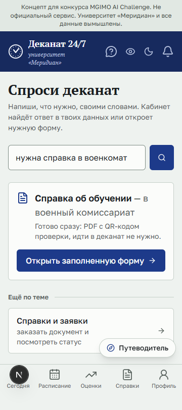 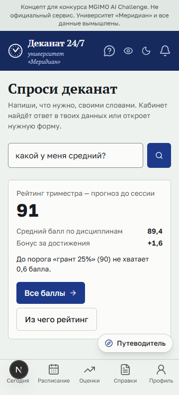

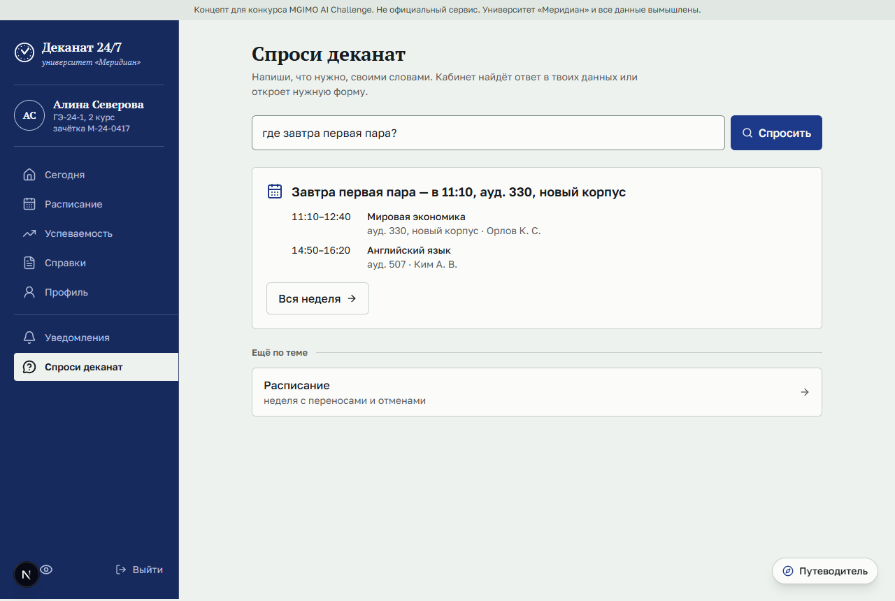

**Что учли:**
- Разбор вопроса — отдельный модуль без доступа к базе (`src/lib/ask/intents.ts`). Данные подставляет страница через обычный слой доступа: только свои, как везде.
- «пар» ловится только как слово «пара» в падежах, иначе «как сменить пароль» уводил в расписание. На это есть тест.
- Назначение справки из адреса подставляется, только если оно есть в списке вариантов. Произвольный текст из ссылки в справку не попадёт: это проверяет e2e-тест.
- Форма поиска — обычный GET: работает и без JavaScript, вопрос виден в адресе, ответом можно поделиться.

**Как проверили:** 12 юнит-тестов разбора, включая «каждый пример из подсказок понимается» и «непонятное — пустой ответ, а не случайный раздел». 4 e2e-теста: справка с назначением, карточки рейтинга и пар, непонятный вопрос и мусор в адресе формы, значок в шапке на 360 px.

**Что пошло не так:**
1. **В карточке пар было «ауд. ауд. 330»:** номер аудитории в базе уже начинается с «ауд.». Заметили на снимке экрана, лишний префикс убрали.
2. **Регулярка для «пара» сначала не работала:** в строке JS `\s` превратился в `s`. Поймали, когда проверяли файл после правки.

**Осталось автору:** решить, подключать ли настоящий ИИ. Разбор по ключевым словам останется запасным режимом на случай, если ИИ недоступен.

**Вручную:** ничего.

---

## Этап 33. Оценка преподавания — 18.11.2026

**Промпт автора:** «Продолжай делать всё в том же духе» — следующий пакет из сверки PRD: оценка преподавания (P2).

**Что появилось:**
- **У студента:** «Успеваемость» → «Оценить курсы триместра». Курсы текущего триместра, у каждого — «оценить» или «оценено». В анкете три вопроса по шкале 1–5: понятно ли объясняет, полезны ли занятия, справедливо ли оценивает. Плюс необязательный комментарий с подсказкой не писать того, по чему легко узнать автора. Ответить можно один раз.
- **У преподавателя:** третья вкладка курса «Отзывы». Средняя по каждому вопросу, распределение оценок 5…1 и комментарии. Пока ответов меньше 5, видно только «Пока 3 ответа из 8» и сколько ещё нужно.
- **«Спроси деканат»** понимает «оценить преподавателя», «отзыв», «анкета».
- **Сид:** у английского в ГЭ-24-1 шесть ответов одногруппников (сводка видна), в МП-23-2 три (видно, как работает порог). Главные студенты не отвечали — жюри может ответить само.

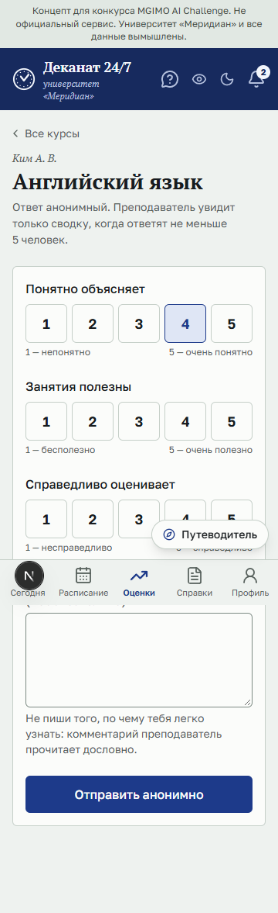 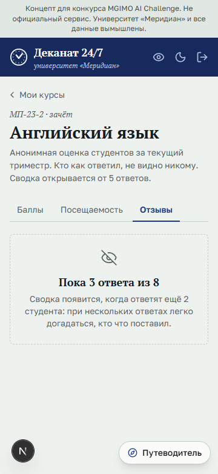

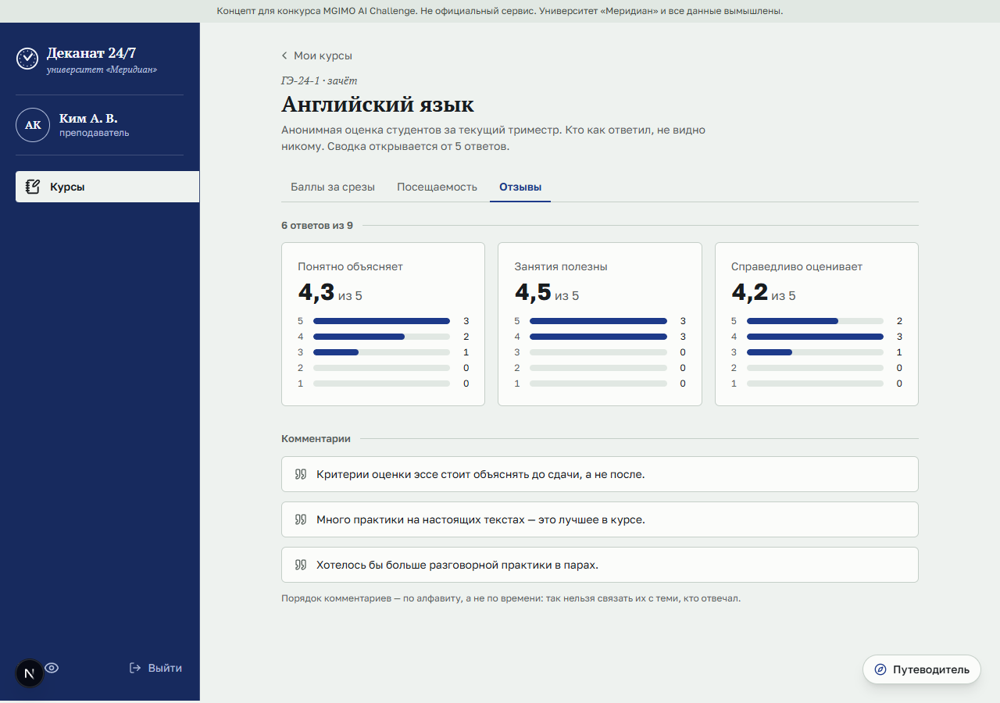

**Как устроена анонимность:**
- Ответ (`course_feedback`) хранится без id студента и без времени. Отдельная таблица (`course_feedback_votes`) помнит только, что студент уже ответил на курс.
- Порог в 5 ответов: при двух-трёх ответах легко догадаться, кто что поставил.
- Комментарии показываются по алфавиту, а не по порядку ответов.
- Честное ограничение: тот, у кого есть прямой доступ к базе, теоретически может сопоставить ответ с голосом по физическому порядку строк. В интерфейсе и в коде такой связи нет. Для настоящего вуза стоило бы добавлять ответы пачками или перемешивать.

**Как проверили:** 5 юнит-тестов правил: разбор ответа, порог, средние, порядок комментариев. 3 e2e-теста:
- студент оценивает → преподаватель видит 7-й ответ и комментарий без имени автора, повторно ответить нельзя;
- ниже порога сводки и комментариев нет;
- **чужой курс — 404** и для студента другой группы, и для чужого преподавателя.

Слой доступа: функции студента с id курса проверяются тем же тестом, что заявки и уведомления, — выборка ограничена студентом из сессии.

**Что пошло не так:**
1. **На телефоне три вкладки курса не помещались:** «Баллы за срезы» переносилась на две строки. На узком экране подпись теперь «Баллы».
2. **Тест «чужой курс» падал на втором входе в той же вкладке:** вошедшего пользователя страница входа сразу перенаправляет. Преподаватель вошёл в отдельном окне браузера.

**Дополнение (после этапа 34).** В «Сводке» деканата появился раздел «Оценка преподавания»: средняя по трём вопросам для каждого курса текущего триместра, где ответов не меньше 5. Курсы с меньшим числом ответов только посчитаны. Комментарии деканат не видит: они адресованы преподавателю. e2e-тест проверяет, что текст комментария в сводке не появляется.

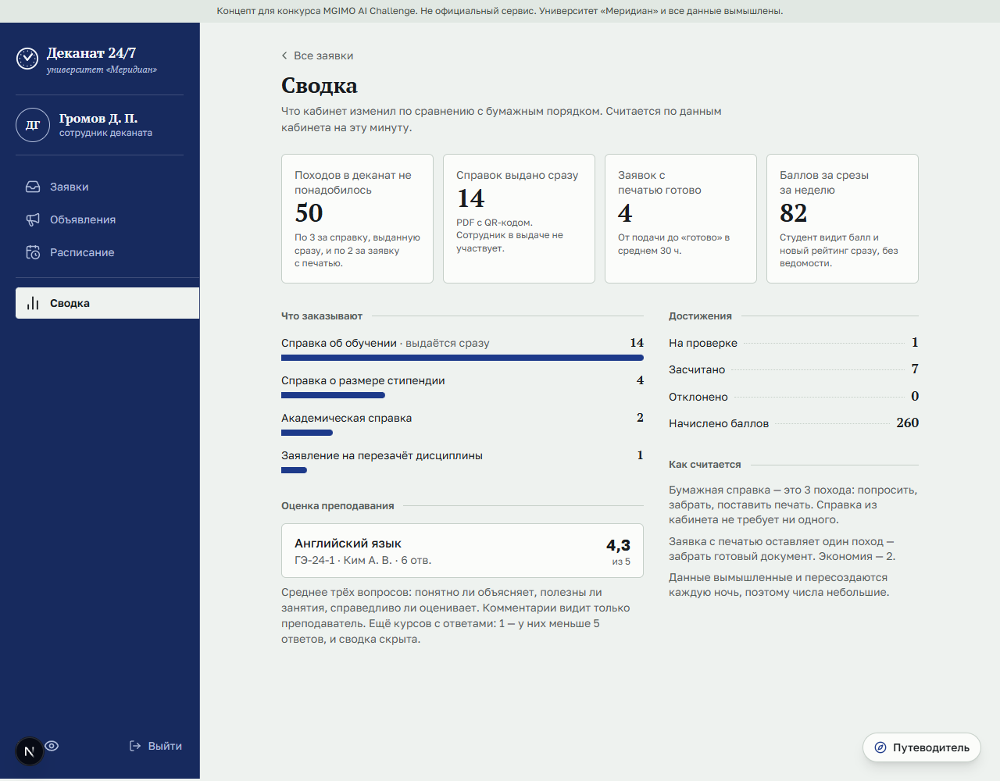

**Вручную:** ничего.

---

## Этап 34. Активность и бонус у преподавателя — 18.11.2026

**Промпт автора:** «Продолжай делать всё в том же духе» — последний пробел кабинета преподавателя из PRD 5.7: активность, бонус, оценки сессии.

**Что появилось:** четвёртая вкладка курса «Активность и бонус» (на телефоне — «Итоги»). У каждого студента:
- среднее по срезам — чтобы видеть, к чему добавляется бонус;
- **активность на занятиях, 0–100.** По GRADING.md это половина вовлечённости, то есть 15% балла дисциплины. Пусто значит «ещё не оценена», и кабинет студента считает вовлечённость по одной посещаемости;
- **бонус за особые успехи, 0…+5** — к работе в триместре. О новом или увеличенном бонусе студент получает уведомление.

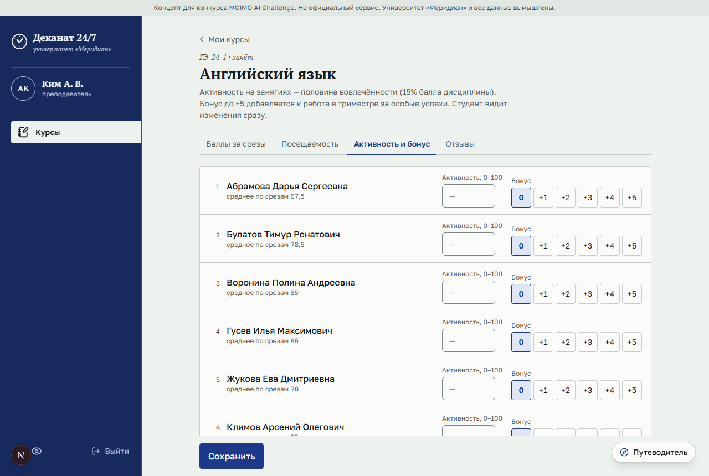 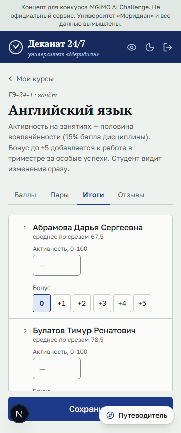

**Решение ИИ:** оценки сессии не вводятся. Сессия по правилам начинается после 12-й недели триместра. Если дать ввести её посреди триместра, прогноз у студента подменился бы «сданной» оценкой, а это неправда. В архиве прошлых триместров оценки сессии есть, они из исходных данных.

**Что учли:** как у журнала и посещаемости — только свой курс текущего триместра и только студенты его группы, чужие id отбрасываются, чужой курс — 404. Проверка диапазонов на сервере: 150 в активности не сохранится, даже если обойти поле формы. Сохраняются только изменённые строки, повторное нажатие пишет «Изменений нет».

**Как проверили:** 2 e2e-теста: неверная активность не сохраняется; бонус доходит до студента уведомлением, а значения остаются в форме; чужой курс и мусор в адресе — 404. Заодно проверили, что на 360 px в версии для слабовидящих (150%) новые страницы этой ночи — «Спроси деканат», оценка преподавания, отзывы, итоги, объявления — не уезжают вбок.

**Вручную:** ничего.

---

## Этап 35. Проверка прода и выписка за всё время — 18.11.2026

**Промпт автора:** «Зашёл в акк, проверь всё», затем «Выписка за всё время».

**Проверка прода.** После выкатки ИИ прошёл новые функции под тремя ролями в браузере автора: автор входил сам, ИИ паролей не видел. Всё работало, нашлись пять мелочей, все исправлены:
- «Ты уже оценил этот курс» видела студентка — теперь «Курс уже оценён». Там же в форме заказа «другое — напишу сам» стало «другое — впишу своё»;
- в «Спроси деканат» рейтинг был «91», везде в кабинете «91,0»;
- на странице 404 сотрудник видел «у тебя нет доступа», а в /staff на «ты» не обращаемся. Страница общая, текст стал нейтральным;
- поле «Активность» в каждой строке называлось одинаково, скринридер не говорил, чья это строка;
- демо-объявление звало записываться на курсы по выбору «в разделе „Профиль“», которого нет.

**Что появилось:** у выписки рейтинга выбор периода — «текущий триместр» или «всё время обучения». Во второй — все закрытые триместры по порядку, у каждого таблица дисциплин и рейтинг триместра, пересдачи помечены звёздочкой. Последним идёт текущий триместр с годовыми рейтингами и местом на курсе. «Спроси деканат» понимает «выписка за всё время» и открывает форму с выбранным периодом.

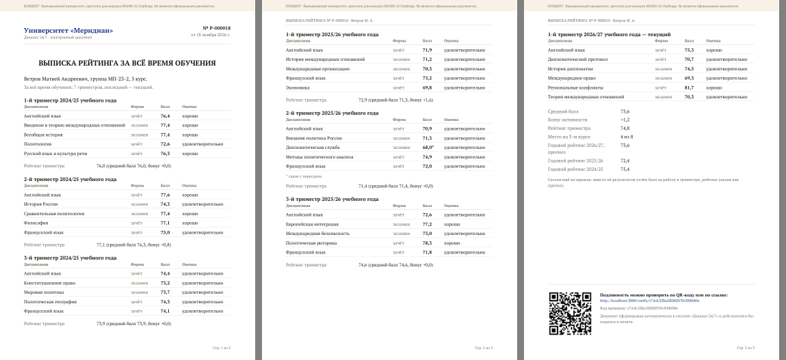

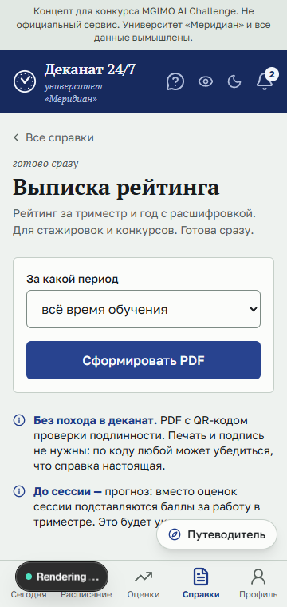 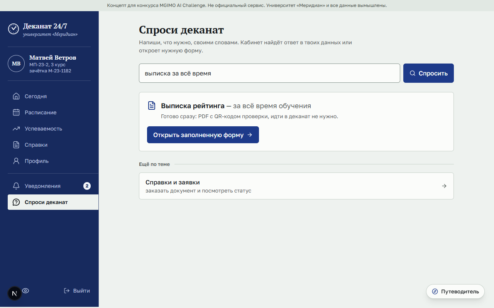

**Решение ИИ:** раньше PDF умел только одну страницу, поэтому выписку «за всё время» откладывали. Теперь документ сам переносится: шапка таблицы повторяется, на каждой следующей странице — пометка «концепт», номер документа и владелец, внизу «Стр. 1 из 3». Триместр не разрывается между страницами, если помещается целиком. QR-код всегда на последней странице.

**Что учли:** выписка за триместр осталась прежней, это значение по умолчанию. Период из адреса подставляется только из списка: подмена на «1990 год» не сработает. Данные собираются тем же слоем доступа — только свои триместры и свои оценки.

**Как проверили:** 3 юнит-теста на PDF (несколько страниц, заголовок, длинная таблица одного триместра), 2 теста разбора вопроса и 2 e2e-теста: из «Спроси деканат» до скачанного PDF на несколько страниц, и по умолчанию — текущий триместр. Настоящую выписку `student2` посмотрели глазами: 7 триместров на 3 страницах.

**Вручную:** ничего.
